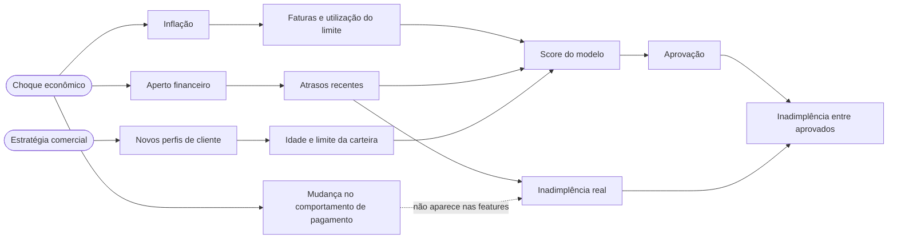

# Tech Challenge FIAP Fase 04 — Sustentação e Confiabilidade de um Modelo de Crédito


Camada de **sustentação e confiabilidade** de um modelo de *credit scoring* em produção: um contrato de dados que barra lotes inválidos antes da escoragem, a simulação de doze meses de degradação (drift de dados e de conceito), a detecção estatística dessa degradação, a observabilidade do pipeline e do modelo, e a governança do processo sob a LGPD, com análise causal do problema.

Repositório: <https://github.com/marcoaadc/tech-challenge-fase4-monitoramento-credito>

| Para ver | Abrir no navegador | Arquivo no repositório |
|---|---|---|
| **Dashboard de monitoramento** | **[abrir o dashboard](https://marcoaadc.github.io/tech-challenge-fase4-monitoramento-credito/reports/dashboard/index.html)** | [`reports/dashboard/index.html`](reports/dashboard/index.html) |
| Evidently — mar/2025, fase estável | [abrir o relatório](https://marcoaadc.github.io/tech-challenge-fase4-monitoramento-credito/reports/evidently/drift_2025-03.html) | [`drift_2025-03.html`](reports/evidently/drift_2025-03.html) |
| Evidently — ago/2025, drift de dados | [abrir o relatório](https://marcoaadc.github.io/tech-challenge-fase4-monitoramento-credito/reports/evidently/drift_2025-08.html) | [`drift_2025-08.html`](reports/evidently/drift_2025-08.html) |
| Evidently — dez/2025, drift de conceito | [abrir o relatório](https://marcoaadc.github.io/tech-challenge-fase4-monitoramento-credito/reports/evidently/drift_2025-12.html) | [`drift_2025-12.html`](reports/evidently/drift_2025-12.html) |
| Lote bloqueado pelo contrato | — | [`blocked_2025-07-r1.json`](reports/data_quality/blocked_2025-07-r1.json) |
| Causalidade, viés e remediação | — | [`analysis_report.md`](reports/analysis/analysis_report.md) |
| Alertas, métricas e eventos | — | [`alerts.jsonl`](reports/observability/alerts.jsonl) · [`metrics.prom`](reports/observability/metrics.prom) · [`pipeline_events.jsonl`](reports/observability/pipeline_events.jsonl) |

Os relatórios HTML são publicados pelo GitHub Pages a partir da branch `main`. Eles também são autocontidos: depois de clonar, basta abrir os arquivos no navegador.

---

## 1. O problema

Uma fintech de concessão de crédito tem um modelo de *credit scoring* em produção. Com a inflação e a entrada de novos perfis de cliente, a diretoria suspeita que o modelo esteja decidindo mal — e ninguém sabe dizer se está, porque um modelo de crédito degrada **em silêncio**: ele continua respondendo, a API não cai, nenhum erro aparece no log. A perda só surge meses depois, na inadimplência da carteira aprovada.

Este projeto constrói o que faltava para responder a três perguntas, nesta ordem:

1. **O dado que chega é válido?** → contrato de dados (Etapa 1)
2. **O dado que chega ainda se parece com o do treino? O modelo ainda acerta?** → detecção de drift e de degradação (Etapas 2 e 3)
3. **O processo é defensável perante o titular e o regulador? Por que degradou e o que fazer?** → governança, LGPD e análise causal (Etapa 4)

**Dataset:** [*Default of Credit Card Clients*](https://doi.org/10.24432/C55S3H) (UCI, licença CC BY 4.0) — 30.000 clientes de cartão de crédito, com limite, seis meses de histórico de pagamento e o indicador de inadimplência. Depois da limpeza são 29.965, divididos ao meio:

| | Linhas | Papel |
|---|---|---|
| **Dataset de Referência** | 14.982 (treino 8.989 · validação 2.996 · teste 2.997) | Única base usada para treinar e avaliar o modelo; linha de base do drift |
| **Dataset de Produção** | 12 remessas mensais de 2.000 propostas, amostradas dos outros 14.983 clientes | Onde a degradação é simulada; nunca visto no treino |

## 2. Resultados em uma página


O cenário cobre doze meses de produção: três estáveis (controle), cinco com drift de dados e quatro com drift de conceito.

| Mês | Fase | Features com drift | PSI do score | Aprovação | ROC AUC | Inadimplência entre aprovados |
|---|---|---|---|---|---|---|
| referência | — | — | — | 74,9% | 0,777 | 12,3% |
| jan–mar | Estável | 0 | ≤ 0,01 | 76% a 77% | 0,773 a 0,786 | 12,2% a 12,4% |
| abr | Drift de dados | 3 | 0,01 | 74,6% | 0,775 | 12,7% |
| jun | Drift de dados | 12 | 0,07 | 64,6% | 0,797 | 14,9% |
| ago | Drift de dados | 23 | 0,23 | 54,9% | 0,791 | 15,8% |
| set | Drift de conceito | 19 | 0,25 | 53,5% | 0,741 | 19,7% |
| out | Drift de conceito | 19 | 0,24 | 56,0% | 0,690 | 23,8% |
| dez | Drift de conceito | 19 | 0,23 | 55,7% | **0,613** | **30,7%** |

O que o monitoramento mostra:

- **O contrato barra o dado ruim.** O arquivo original da UCI reprova (399 linhas com códigos fora do dicionário) e, em julho, uma remessa corrompida pela origem é bloqueada com sete regras violadas — 2.040 linhas em quarentena, nenhuma escorada.
- **Nenhum alarme falso.** Nos três meses de controle, nenhuma feature em drift e nenhum alerta.
- **O drift de dados é detectado em abril**, cinco meses antes de o modelo piorar.
- **Drift de dados não é modelo ruim.** De abril a agosto, 23 das 30 features mudam e o ROC AUC *não cai*. O que cai é a taxa de aprovação, de 76% para 55%: a carteira ficou mais arriscada e o modelo percebeu.
- **O drift de conceito é o que derruba o modelo**, e não aparece nos testes de entrada. O AUC vai de 0,777 para 0,613 e a inadimplência entre os aprovados passa de 12,3% para 30,7%. Com rótulos que amadurecem em dois meses, a queda de setembro só é mensurável em novembro.
- **A causa foi isolada.** Das quatro mudanças simuladas, o drift de conceito responde por −0,161 dos −0,157 de variação do AUC; as outras três, que disparam os alarmes de drift, somam +0,004 ([seção 9](#9-análise-causal-da-degradação)).
- **Retreinar recupera parte.** Um desafiante treinado com as safras recentes leva o AUC de 0,632 para 0,699 nos dois meses seguintes.

Foram **29 alertas** em doze meses (18 críticos), no máximo um alerta de drift de dados por remessa.

## 3. Arquitetura

```
                        ┌─────────────────── Dataset de Referência ───────────────────┐
 UCI (CSV, SHA-256) ──▶ ingest ──▶ contrato ✗ bruto reprova ──▶ limpeza ──▶ contrato ✓ ──▶ referência ──▶ train
                                                                                  │                        │
                                                                                  ▼                        ▼
                                                                    metade reservada (produção)     model.joblib
                                                                                  │                 metadata.json
                                                                                  ▼                 (SHA-256, MLflow)
                        ┌──────────────────── Dataset de Produção ────────────────────┐                   │
                        │ simulate: 12 remessas mensais (inflação, aperto financeiro, │                   │
                        │ novos perfis, drift de conceito) + 1 remessa corrompida     │                   │
                        └──────────────────────────────┬──────────────────────────────┘                   │
                                                       ▼                                                  │
 monitor, por remessa:  read_batch ──▶ contract ──▶ score ◀───────────────────────────────────────────────┘
                                          │           │
                              ✗ quarentena + alerta   ├──▶ drift       PSI · KS · qui² contra a referência
                              (nada é escorado)       ├──▶ performance AUC · KS · calibração (rótulo maduro)
                                                      └──▶ evidently   relatório HTML nos checkpoints
                                                       │
            ┌──────────────────────────────────────────┼─────────────────────────────────────────┐
            ▼                        ▼                 ▼                    ▼                    ▼
   pipeline_events.jsonl       alerts.jsonl       metrics.prom           MLflow          logs/pipeline.jsonl
   (saúde dos estágios)     (6 famílias)        (Prometheus)      (treino + série        (JSON, run_id)
            │                        │                 │          temporal por remessa)
            └────────────────────────┴────────┬────────┘
                                              ▼
 analyze: causalidade · viés · remediação ──▶ dashboard: reports/dashboard/index.html
```

Cada estágio é uma função `run_*` em [`src/creditwatch/pipelines/`](src/creditwatch/pipelines/), chamada pela CLI, pelo orquestrador `run_all` e pelos testes.

## 4. Como executar

**Requisitos:** Python 3.10 a 3.12 e [Poetry](https://python-poetry.org/) ≥ 2.0. O `make` é opcional (no Windows, use Git Bash); cada alvo tem um comando Poetry equivalente.

```bash
git clone https://github.com/marcoaadc/tech-challenge-fase4-monitoramento-credito.git
cd tech-challenge-fase4-monitoramento-credito
poetry install                  # ou: make install
cp .env.example .env            # opcional; todos os valores têm defaults
```

O repositório já traz os dados, o modelo e os relatórios da execução de referência. Para refazer tudo:

```bash
make pipeline
# equivalente:
CREDITWATCH_MLFLOW_TRACKING_URI=sqlite:///mlflow.db poetry run python -m creditwatch.pipelines.run_all
```

Leva de um a dois minutos e executa, em sequência:

| Estágio | Comando | O que faz | Saída principal |
|---|---|---|---|
| `ingest` | `python -m creditwatch.pipelines.ingest` | Confere o SHA-256 do bruto, valida, limpa, exige o contrato e separa referência × produção | `data/reference/`, `reports/data_quality/` |
| `train` | `python -m creditwatch.pipelines.train` | Treina Regressão Logística e XGBoost, escolhe por ROC AUC de validação | `models/`, `reports/model/` |
| `simulate` | `python -m creditwatch.pipelines.simulate` | Gera as remessas mensais e a remessa corrompida | `data/production/` |
| `monitor` | `python -m creditwatch.pipelines.monitor` | Contrato, escoragem, drift, performance, alertas, Evidently | `reports/monitoring/`, `reports/observability/`, `reports/evidently/` |
| `analyze` | `python -m creditwatch.pipelines.analyze` | Atribuição causal, auditoria de viés, remediação | `reports/analysis/` |
| `dashboard` | `python -m creditwatch.pipelines.dashboard` | Consolida tudo em um HTML | `reports/dashboard/index.html` |

**Demonstração do contrato bloqueando um lote ruim** (o comando termina com código de saída 1):

```bash
make demo-bad-batch
# equivalente:
poetry run python -m creditwatch.pipelines.validate data/production/batch_2025-07_remessa1_corrompida.parquet
```

**Rastreamento e relatórios:**

```bash
make mlflow-ui        # MLflow em http://127.0.0.1:5000
make serve-reports    # dashboard em http://127.0.0.1:8000/dashboard/
make evidently-all    # relatório do Evidently para os 12 meses (o padrão gera 3 checkpoints)
```

## 5. Etapa 1 — Validação de dados e contrato

Contrato em [Pandera](https://pandera.readthedocs.io/), com um catálogo de regras de identificador estável ([`contracts/`](src/creditwatch/contracts/)). Detalhes em [docs/contrato_de_dados.md](docs/contrato_de_dados.md).

| Regra | O que exige |
|---|---|
| `DQ-01` Completude | Nenhuma coluna obrigatória com valor nulo |
| `DQ-02` Idade válida | Idade entre 18 e 100 |
| `DQ-03` Limite de crédito | Limite entre 1.000 e 1.000.000 (teto da política) |
| `DQ-04` Unicidade | `customer_id` sem repetição no lote |
| `DQ-05` Domínio dos categóricos | `sex`, `education`, `marriage` restritos ao dicionário |
| `DQ-06` a `DQ-08` | Status de pagamento entre −2 e 8, pagamentos não negativos, faturas em faixa plausível |
| `DQ-09` Esquema estrito | Todas as colunas presentes e **nenhuma coluna extra** (bloqueia PII enviada por engano) |
| `DQ-10` a `DQ-13` | Tipos inteiros, volume mínimo, rótulo binário, mês de referência único |
| `DQ-W01` (aviso) | Menos de 60% da carteira sem consumo no mês |

Quando um lote reprova, ele vai inteiro para a quarentena, um relatório diz qual regra falhou e em quantas linhas, um alerta crítico é emitido e **nada é escorado**:

```
Contrato: credit_batch | Lote: batch_2025-07_remessa1_corrompida | 2040 linhas x 26 colunas
Resultado: BLOQUEADO
Linhas com pelo menos uma falha: 246

Regra    Falhas  Titulo                     Colunas
DQ-01        60  Completude                 limit_bal
DQ-02        40  Idade válida               age
DQ-03        20  Limite de crédito          limit_bal
DQ-04        80  Unicidade                  customer_id
DQ-05        40  Domínio dos categóricos    education, sex
DQ-07        20  Pagamentos não negativos   pay_amt_1
DQ-09         1  Esquema estrito            cpf
```

O contrato trata de valores **inválidos**. Mudança de distribuição de valores válidos não reprova o lote: é assunto da detecção de drift. O modelo baseline (XGBoost, ROC AUC 0,780 e KS 0,445 no teste) está descrito no [Model Card](docs/model_card.md).

## 6. Etapa 2 — Simulação e detecção de drift

Quatro mecanismos independentes alteram as remessas de produção ([`simulation/`](src/creditwatch/simulation/)); detalhes e tabelas completas em [docs/drift.md](docs/drift.md).

| Mecanismo | Tipo | O que muda | Variáveis afetadas |
|---|---|---|---|
| Inflação | drift de dados | Faturas até 70% maiores em termos nominais; pagamentos acompanham só 35% disso | `bill_amt_*`, `pay_amt_*`, utilização, razão de pagamento |
| Aperto financeiro | drift de dados | Mais clientes com atraso recente | `pay_status_*`, `max_delay`, `months_delayed` |
| Novos perfis | drift de dados | Clientes mais jovens e com limite menor | `age`, `limit_bal` |
| Drift de conceito | drift de conceito | Bons pagadores alavancados passam a inadimplir; parte dos inadimplentes é curada | nenhuma feature — só a relação entre features e inadimplência |

Cada remessa é comparada com a referência em 30 features: PSI em todas, Kolmogorov-Smirnov nas numéricas e qui-quadrado nas categóricas ([`drift/`](src/creditwatch/drift/)). A severidade é decidida pelo **tamanho do efeito** (PSI ≥ 0,10 atenção, ≥ 0,25 crítico), porque com milhares de linhas o p-valor acusa qualquer diferença: em dezembro, 29 das 30 features têm p < 0,001 ([ADR 002](docs/adr/002-psi-como-criterio-de-drift.md)).

Features degradadas em dezembro:

| Feature | PSI | Teste | Estatística | Situação |
|---|---|---|---|---|
| `utilization_1` | 0,905 | KS | 0,441 | crítico |
| `bill_trend` | 0,658 | KS | 0,349 | crítico |
| `utilization_avg` | 0,570 | KS | 0,337 | crítico |
| `payment_ratio_1` | 0,519 | KS | 0,249 | crítico |
| `pay_status_1` | 0,302 | qui² | 0,198 | crítico |
| `max_delay` | 0,279 | qui² | 0,193 | crítico |
| `limit_bal` | 0,236 | KS | 0,206 | atenção |
| `age` (fora do modelo) | 0,127 | KS | 0,151 | atenção |

O **Evidently AI** gera o relatório HTML de cada checkpoint, com o mesmo método e os mesmos limiares, e serve de contraprova: tudo o que ele aponta o detector próprio também aponta ([`tests/test_integrations.py`](tests/test_integrations.py)).

## 7. Etapa 3 — Observabilidade

Detalhes, catálogo completo de métricas e exemplos em [docs/observabilidade.md](docs/observabilidade.md).

| O que | Onde | Como |
|---|---|---|
| **Logs centralizados** | `logs/pipeline.jsonl` | Todos os estágios no mesmo arquivo JSON Lines, com o `run_id` da execução; nunca valores de linhas |
| **Eventos de estágio** | [`pipeline_events.jsonl`](reports/observability/pipeline_events.jsonl) | Um evento por estágio: status (`success`, `blocked`, `failed`), duração, linhas de entrada e de saída |
| **Alertas** | [`alerts.jsonl`](reports/observability/alerts.jsonl) | Seis famílias: qualidade de dados, drift de dados, drift de predição, drift do alvo, performance e calibração |
| **Rastreamento** | MLflow (`sqlite:///mlflow.db`) | Experimento de treino com o modelo registrado; experimento de monitoramento com a série temporal de cada métrica e um run por remessa |
| **Métricas** | [`metrics.prom`](reports/observability/metrics.prom) | Formato Prometheus (textfile collector ou Pushgateway), para integrar à stack da Fase 3 |
| **Dashboard** | [`reports/dashboard/index.html`](reports/dashboard/index.html) | HTML único, sem dependência externa, com tabela equivalente para cada gráfico |

Métricas de saúde escolhidas:

| Grupo | Métricas | Disponível |
|---|---|---|
| Pipeline | Execuções de estágio por resultado, duração por estágio, remessas escoradas e bloqueadas, linhas escoradas e em quarentena, violações por regra | a cada execução |
| Drift | PSI por feature, número e fração de features com drift, PSI do score, taxa de aprovação | no dia da escoragem |
| Modelo | ROC AUC, KS, calibração, taxa de inadimplência, inadimplência entre aprovados | após a maturação do rótulo (2 meses) |
| Alertas | Contagem por família e severidade | a cada execução |

Na execução de referência: 13 remessas, 12 escoradas (24.000 propostas) e 1 bloqueada; 66 execuções de estágio no monitoramento, 65 com sucesso, 1 bloqueio e nenhuma falha. O que fazer diante de cada alerta está no [runbook](docs/runbook.md).

## 8. Etapa 4 — Governança e LGPD

Plano de proteção de dados do projeto. É um desenho acadêmico, baseado na Lei 13.709/2018 (LGPD) e na legislação de crédito, e não substitui a análise do jurídico e do encarregado de uma operação real.

### 8.1 Papéis e escopo

| Papel | Quem | Responsabilidade |
|---|---|---|
| Controlador | A fintech | Decide a finalidade (análise de risco de crédito) e responde pelo tratamento |
| Operador | Provedores de infraestrutura e de dados | Tratam os dados conforme as instruções do controlador |
| Encarregado (DPO) | Indicado pelo controlador (art. 41) | Canal com os titulares e com a ANPD; recebe os alertas de privacidade do [runbook](docs/runbook.md) |
| Comitê de modelos | Risco, dados, jurídico e encarregado | Aprova a promoção de modelos e as mudanças de política |

### 8.2 Inventário de dados pessoais

| Dado | Classificação | Finalidade | Entra no modelo |
|---|---|---|---|
| `customer_id` | Identificador pseudonimizado | Unicidade do lote e ligação entre proposta, decisão e rótulo | não |
| `limit_bal`, `pay_status_*`, `bill_amt_*`, `pay_amt_*` | Dado pessoal financeiro | Estimar o risco de inadimplência | sim |
| `age` | Dado pessoal | Validar a capacidade civil (≥ 18 anos) e auditar viés | não |
| `sex`, `marriage`, `education` | Dado pessoal com potencial discriminatório | Somente auditoria de viés | não |
| `default` | Dado pessoal financeiro (rótulo) | Treinar o modelo e medir o desempenho | alvo |
| `score`, `approved` | Dado pessoal derivado (perfil, art. 12, § 2º) | Decisão de crédito | saída |

O dataset não contém identificadores diretos (nome, CPF, contato) nem dados pessoais sensíveis na definição do art. 5º, II. Sexo, idade, estado civil e escolaridade não são "sensíveis" nessa definição, mas podem servir a discriminação e por isso recebem tratamento reforçado.

### 8.3 Como os dados pessoais foram tratados neste projeto

Medidas de *privacy by design* e *by default* (art. 46, § 2º) que existem no código, e não só no papel:

| Princípio (art. 6º) | Medida | Onde |
|---|---|---|
| Necessidade (minimização) | O contrato é **estrito**: qualquer coluna fora do esquema reprova o lote. Um `cpf` enviado por engano é bloqueado antes de chegar ao modelo | [`credit_contract.py`](src/creditwatch/contracts/credit_contract.py), regra `DQ-09` |
| Necessidade | O modelo usa só as 26 variáveis financeiras; um teste garante que nenhum atributo sociodemográfico entra | [`schema.py`](src/creditwatch/data/schema.py), [ADR 004](docs/adr/004-atributos-protegidos-fora-do-modelo.md) |
| Finalidade | Atributos protegidos têm uso declarado e restrito à validação de maioridade e à auditoria de viés | [`fairness.py`](src/creditwatch/analysis/fairness.py) |
| Segurança | Logs e eventos registram contagens e nomes de regras, nunca valores de linhas | [`observability/`](src/creditwatch/observability/) |
| Segurança | O relatório de falha não registra valores de colunas inesperadas nem identificadores de cliente; um teste confirma que nenhum CPF vaza | [`gate.py`](src/creditwatch/contracts/gate.py), [`test_contract.py`](tests/test_contract.py) |
| Segurança | Lotes em quarentena e predições ficam fora do repositório (`.gitignore`) | `data/quarantine/`, `data/predictions/` |
| Prevenção | Os CPFs do lote de demonstração são fictícios e inválidos por construção: nunca reproduzem o documento de uma pessoa real | [`corruption.py`](src/creditwatch/simulation/corruption.py) |
| Qualidade dos dados | Nenhum lote é escorado sem passar no contrato; o treino só usa o dataset limpo e validado | [`ingest.py`](src/creditwatch/pipelines/ingest.py), [`monitor.py`](src/creditwatch/pipelines/monitor.py) |
| Transparência e responsabilização | Cada predição guarda a versão do modelo; `metadata.json` guarda o SHA-256 do dataset e do artefato, hiperparâmetros e métricas; cada execução tem um `run_id` | [`registry.py`](src/creditwatch/model/registry.py) |
| Não discriminação | Auditoria de viés a cada execução, por sexo, idade, escolaridade e estado civil | seção 8.7 |

### 8.4 Base legal para a decisão de crédito

| Tratamento | Base legal | Fundamento |
|---|---|---|
| Análise de risco e cálculo do score | **Proteção do crédito** (LGPD, art. 7º, X) | Base específica para a atividade; a Súmula 550 do STJ reconhece o *credit scoring* como prática lícita que dispensa o consentimento, garantido ao consumidor o direito a esclarecimentos sobre os dados considerados |
| Processamento da proposta | Procedimentos preliminares a contrato, a pedido do titular (art. 7º, V) | O cliente solicita o crédito |
| Guarda de registros e gestão de risco | Cumprimento de obrigação legal ou regulatória (art. 7º, II) | Normas do CMN e do Banco Central sobre gerenciamento de risco de crédito |
| Monitoramento de drift e auditoria de viés | Legítimo interesse (art. 7º, IX, e art. 10) | Prevenir decisões erradas e discriminatórias, em benefício também do titular; exige teste de balanceamento documentado |

O **consentimento não é a base** desse tratamento: além de dispensado pela Súmula 550, ele pode ser revogado a qualquer momento, o que o torna inadequado para uma análise de risco. Limites que continuam valendo:

- **Lei 12.414/2011 (Cadastro Positivo), art. 3º, § 3º:** proíbe informações excessivas e informações sensíveis (origem social e étnica, saúde, informação genética, orientação sexual, convicções políticas, religiosas e filosóficas) na análise de crédito. O modelo não usa nenhuma delas.
- **Código de Defesa do Consumidor, art. 43:** direito de acesso às informações e limite de cinco anos para informações negativas.
- **LGPD, art. 6º, IX:** vedação de tratamento para fins discriminatórios ilícitos ou abusivos.

### 8.5 Decisão automatizada e direitos do titular

A decisão de crédito é automatizada, e o titular pode pedir a sua revisão e informações claras sobre os critérios usados (LGPD, art. 20; Lei 12.414/2011, art. 5º, IV e VI). O que o projeto oferece para isso:

- **Rastreabilidade:** cada predição registra a versão do modelo, e os metadados levam ao dataset e ao código que o produziram.
- **Explicabilidade:** o modelo usa apenas comportamento financeiro; três variáveis de histórico de atraso concentram 62% da importância. Os principais fatores de uma negativa podem ser informados sem expor atributos pessoais.
- **Revisão humana:** propostas próximas do ponto de corte e negativas contestadas vão para análise de um analista de crédito ([runbook](docs/runbook.md), seção 4).
- **Demais direitos (art. 18):** confirmação, acesso, correção e eliminação são atendidos pelo canal do encarregado; como os lotes são particionados por mês e identificados por `customer_id`, a localização dos dados de um titular é direta.

### 8.6 Plano de retenção

| Dado | Prazo | Justificativa | Ao fim do prazo |
|---|---|---|---|
| Propostas aprovadas e histórico do contrato | Vigência do contrato + 5 anos | Prescrição de cobrança de dívidas líquidas (Código Civil, art. 206, § 5º, I) e guarda regulatória | Eliminação ou anonimização |
| Propostas negadas | Até 5 anos, com acesso restrito ao jurídico após 12 meses | Defesa em contestações (CDC, art. 27) e atendimento ao direito de revisão | Eliminação |
| Informação de inadimplência | No máximo 5 anos | CDC, art. 43, § 1º | Eliminação |
| Dataset de Referência | Vida útil do modelo + 5 anos | Reprodutibilidade e auditoria da decisão automatizada | Anonimização (art. 16, IV) ou eliminação |
| Remessas de produção e predições | 5 anos | Rastreabilidade de cada decisão | Eliminação |
| **Quarentena** | **30 dias** | Só o tempo de a origem corrigir e reenviar; o lote pode conter dado fora do contrato | Eliminação; imediata se houver PII indevida |
| Logs e eventos do pipeline | 12 meses | Diagnóstico operacional; não contêm dados pessoais | Eliminação |
| Relatórios de monitoramento | 5 anos | Agregados, sem dados pessoais; evidência de governança | Arquivamento |

A conservação após o término do tratamento se apoia no art. 16, I (obrigação legal ou regulatória). O repositório implementa a parte estrutural do plano — particionamento por mês, quarentena e predições fora do versionamento, limpeza por `make clean`; a eliminação automática por prazo seria tarefa de um orquestrador em produção e não está implementada.

### 8.7 Mitigação de vieses

1. **Atributos protegidos fora do modelo.** Sexo, idade, estado civil e escolaridade não são preditores. A exclusão não custa desempenho: o ROC AUC de teste é 0,781 com ou sem eles (0,7806 contra 0,7809, três seeds).
2. **Auditoria a cada execução**, porque retirar o atributo não retira o seu efeito: as variáveis financeiras podem servir de *proxy*. Mede-se a razão de **impacto desigual** (taxa de aprovação do grupo ÷ taxa do grupo mais aprovado; abaixo de 0,80 indica impacto adverso, pela regra dos quatro quintos) e a taxa de aprovação **entre bons pagadores**.

| Atributo (grupo menos aprovado) | Referência | Drift de dados | Drift de conceito |
|---|---|---|---|
| Sexo (masculino) | 0,94 | 0,94 | 0,91 |
| Faixa etária | 0,95 (18–29) | 0,91 (18–29) | 0,84 (50+) |
| Escolaridade | 0,87 (ensino médio) | **0,83** (ensino médio) | 0,84 (graduação) |
| Estado civil | 0,98 | 1,00 | 0,96 |

3. **Leitura.** Nenhum grupo cruza o limite de 0,80, mas a disparidade existe desde o treino e **cresce com o drift**: a menor razão por escolaridade vai de 0,87 para 0,83 e a menor por faixa etária, de 0,95 para 0,84. Um modelo que degrada não degrada por igual. Por isso a auditoria faz parte do monitoramento, e não só da validação inicial.
4. **Cuidado metodológico.** Grupos com menos de 100 clientes ou de 2% da amostra ficam fora da comparação. Sem esse piso, um grupo de 122 clientes com 82% de aprovação virava a referência e fazia "ensino médio" aparecer com 0,72 — um impacto adverso fabricado por ruído amostral.
5. **Se o limite for cruzado:** investigar *proxies*, comparar a taxa de aprovação entre bons pagadores, registrar a decisão no comitê e garantir a revisão humana das negativas do grupo ([runbook](docs/runbook.md), seção 6).

### 8.8 Riscos e salvaguardas

| Risco para o titular | Salvaguarda |
|---|---|
| Decisão tomada com dado inválido | Contrato bloqueante antes da escoragem |
| Negativa indevida por modelo degradado | Monitoramento de drift e de performance, alertas e runbook com contenção |
| Discriminação indireta | Atributos protegidos fora do modelo e auditoria de viés recorrente |
| Exposição de dados pessoais | Esquema estrito, logs sem dados de linha, quarentena e predições fora do repositório |
| Decisão que não se consegue explicar | Versão do modelo em cada predição, metadados com hashes, modelo baseado só em comportamento financeiro |
| Adulteração do modelo | Verificação do SHA-256 do artefato a cada carga |

Em uma operação real, este tratamento — decisão automatizada com efeito relevante sobre o titular — pede um Relatório de Impacto à Proteção de Dados Pessoais (art. 38) e um plano de resposta a incidentes (art. 48).

## 9. Análise causal da degradação

A detecção diz *que* o modelo piorou; governar exige saber *por quê*. Código em [`analysis/causal.py`](src/creditwatch/analysis/causal.py), resultados em [`analysis_report.md`](reports/analysis/analysis_report.md).

### 9.1 Modelo causal



Três caminhos passam pelas features e portanto pelo score: o modelo os enxerga. O quarto — a mudança de comportamento — vai direto para a inadimplência sem tocar em nenhuma entrada. É esse o caminho que o modelo não vê e que nenhum teste de drift de entrada detecta.

### 9.2 O que causou a queda (intervenção)

Como o cenário é um modelo causal conhecido, cada mecanismo pode ser ligado e desligado isoladamente — o operador *do* de Pearl. As 16 combinações dos quatro mecanismos foram avaliadas com 6.000 propostas cada, e a variação de cada métrica foi repartida por **valores de Shapley**, que somam exatamente o efeito total.

| Mecanismo | ROC AUC | Inadimplência entre aprovados | Features com drift |
|---|---|---|---|
| Inflação | −0,012 | +1,9 p.p. | +7,7 |
| Aperto financeiro | +0,017 | −0,8 p.p. | +7,2 |
| Novos perfis | −0,002 | +1,1 p.p. | +3,2 |
| **Drift de conceito** | **−0,161** | **+14,5 p.p.** | **0,0** |
| Efeito total | −0,157 | +16,7 p.p. | +18,0 |

A coluna da direita e a da esquerda apontam em direções opostas: os três mecanismos de drift de dados explicam **todas** as 18 features em alerta e quase nada da queda de AUC; o drift de conceito explica a queda inteira e **nenhuma** feature em alerta. Quem priorizasse a investigação pelo volume de alarmes procuraria no lugar errado.

O aperto financeiro até *melhora* o AUC: ao trazer mais clientes com atraso, torna a população mais fácil de ordenar, embora mais arriscada.

### 9.3 Onde a relação mudou (o que se vê em produção)

Em produção não há como desligar a inflação. O que se pode fazer é comparar a inadimplência observada com a prevista, por segmento:

| Segmento | Referência: observada / prevista | Drift de conceito: observada / prevista | Diferença |
|---|---|---|---|
| Em dia, baixa utilização do limite | 13,5% / 13,8% | 14,8% / 15,4% | −0,5 p.p. |
| **Em dia, alavancado (utilização ≥ 50%)** | 14,4% / 14,0% | **37,1% / 15,7%** | **+21,4 p.p.** |
| Em atraso | 50,0% / 51,1% | 47,0% / 50,0% | −3,0 p.p. |

O modelo continua calibrado em dois segmentos e erra por 21 pontos em um: clientes em dia e muito alavancados, que ele trata como seguros, passaram a inadimplir. Uma diferença concentrada em um segmento, sem drift correspondente nas suas features, é a assinatura de drift de conceito — e delimita onde agir.

### 9.4 Prescrição

| Horizonte | Ação | Evidência |
|---|---|---|
| Imediato | Endurecer o corte ou reduzir limite para clientes em dia com utilização ≥ 50%; revisão humana perto do corte | Segmento com +21,4 p.p. de erro |
| Curto prazo | Promover um desafiante treinado com as safras recentes, após validação e auditoria de viés | ROC AUC de 0,632 para 0,699 e inadimplência entre aprovados de 29,7% para 26,1% em nov–dez |
| Estrutural | Usar razões em vez de valores nominais; indicadores antecipados (atraso de 30 dias) para encurtar a espera pelo rótulo; retreino em janela deslizante | A inflação move `utilization_1` (PSI 0,90) muito antes de `bill_amt_1` (PSI 0,09); a queda de setembro só é mensurável em novembro |

O retreino recupera parte, não tudo: a mudança continua se intensificando depois da janela de treino. Retreinar é necessário e não dispensa a contenção.

### 9.5 Limites desta análise

- A atribuição por intervenção só é possível porque o gerador é conhecido. Em produção, as causas são hipóteses a testar com dados observacionais (seção 9.3), experimentos e conhecimento de negócio.
- Os valores de Shapley repartem o efeito entre os mecanismos **deste cenário**, com estas intensidades. Outra combinação de choques daria outra repartição.
- A análise por segmento usa uma segmentação escolhida de antemão. Em produção, o segmento afetado precisa ser descoberto, por exemplo comparando a calibração em faixas das variáveis mais importantes.

## 10. Decisões de design

| Decisão | Motivação |
|---|---|
| **Portão bloqueante com quarentena** ([ADR 001](docs/adr/001-pandera-como-contrato-de-dados.md)) | Um lote com defeito indica falha na origem; escorar as linhas "boas" produziria uma amostra enviesada. O lote inteiro é barrado e a origem reenvia |
| **Contrato estrito** | Colunas fora do esquema reprovam o lote: minimização de dados aplicada por padrão |
| **Rótulo separado da proposta** | As remessas chegam sem rótulo e o contrato o proíbe; os rótulos chegam depois, em outro arquivo. O monitoramento distingue o que se sabe no dia da decisão do que só se sabe após a maturação |
| **Tamanho de efeito, não p-valor** ([ADR 002](docs/adr/002-psi-como-criterio-de-drift.md)) | Com milhares de linhas, o p-valor acusa qualquer diferença. O PSI decide; KS e qui-quadrado são evidência |
| **Detector próprio + Evidently** | O detector é transparente e testado função a função; o Evidently gera o relatório e serve de contraprova |
| **Um alerta de drift por remessa** | Vinte e três features em drift viram um alerta com as cinco mais afetadas, não vinte e três alertas |
| **`blocked` diferente de `failed`** | Um bloqueio do contrato é o sistema funcionando; uma falha é defeito do pipeline. Os dois têm tratamento diferente no plantão |
| **Observabilidade sem servidor** ([ADR 003](docs/adr/003-observabilidade-sem-servidor.md)) | O pipeline é um job em lote: eventos estruturados alimentam um dashboard estático, o MLflow e um arquivo Prometheus. Nada precisa estar no ar para ver o resultado |
| **Atributos protegidos fora do modelo, dentro da auditoria** ([ADR 004](docs/adr/004-atributos-protegidos-fora-do-modelo.md)) | Excluí-los não custa desempenho; mantê-los no contrato permite medir a disparidade que a exclusão não elimina |
| **Mecanismos de drift isoláveis** | Cada mecanismo é uma função com intensidade própria; é o que torna possível a atribuição causal |
| **Engenharia de features em uma única função** | Treino, escoragem e monitoramento chamam o mesmo código: sem diferença entre treino e produção |
| **Integridade verificada** | SHA-256 do dataset bruto, do dataset de referência e do artefato do modelo; um modelo adulterado não carrega |
| **Estágios como funções `run_*`** | CLI, orquestrador e testes chamam as mesmas funções; o pipeline inteiro roda em um teste de integração |
| **Falha de observabilidade não derruba o pipeline** | Sem MLflow ou sem Pushgateway, a escoragem acontece igual |

## 11. Qualidade: testes, lint e CI

```bash
make test         # suíte completa: 190 testes, de um a três minutos (inclui Evidently e MLflow reais)
make test-fast    # só os testes de unidade, em segundos
make test-cov     # cobertura (96% em src/creditwatch)
make lint         # ruff check + ruff format --check
```

A suíte cobre as estatísticas de drift, cada regra do contrato (um teste por defeito injetado), os mecanismos de simulação, o treino e a integridade do modelo, as regras de alerta, a observabilidade e as análises. Um teste de integração roda o pipeline completo em um diretório temporário e verifica o que importa para o negócio: nenhum alarme falso nos meses estáveis, a remessa corrompida bloqueada, o drift detectado em abril, a queda de performance em setembro e o drift de conceito apontado como causa.

O workflow [`ci.yml`](.github/workflows/ci.yml) define três jobs, com actions fixadas por SHA e permissão somente de leitura:

| Job | O que faz |
|---|---|
| `lint` | `ruff check` e `ruff format --check` |
| `test` | `pytest` com cobertura mínima de 90%, em Python 3.10, 3.11 e 3.12 |
| `pipeline` | Roda o pipeline completo em um ambiente limpo (baixa o dataset da UCI e confere o hash), verifica que o contrato bloqueia o lote corrompido e aceita o válido, confere os marcos do monitoramento e publica os relatórios como artefato |

O [`dependabot.yml`](.github/dependabot.yml) mantém actions e dependências atualizadas, e os hooks de pre-commit aplicam ruff e verificações de YAML, JSON e TOML.

## 12. Estrutura do repositório

```
├── data/
│   ├── raw/                          # Snapshot da UCI (CC BY 4.0), com SHA-256 conferido
│   ├── reference/                    # Dataset de Referência (treino, validação, teste)
│   └── production/                   # 12 remessas mensais, rótulos, remessa corrompida, manifest.json
├── models/                           # model.joblib + metadata.json (versão, métricas, hashes)
├── reports/
│   ├── dashboard/index.html          # Dashboard de monitoramento
│   ├── evidently/                    # Relatórios do Evidently (3 checkpoints)
│   ├── data_quality/                 # Validação do bruto, do limpo e da remessa bloqueada
│   ├── monitoring/                   # timeline.csv, feature_drift.csv, resumo por remessa
│   ├── observability/                # Eventos de estágio, alertas, métricas Prometheus
│   ├── analysis/                     # Causalidade, viés e remediação
│   └── model/                        # Métricas de treino
├── src/creditwatch/
│   ├── config/                       # Settings (pydantic-settings, prefixo CREDITWATCH_)
│   ├── data/                         # Esquema, download com hash, limpeza, separação
│   ├── contracts/                    # Regras, contrato Pandera, portão e quarentena
│   ├── features/                     # Engenharia de features compartilhada
│   ├── model/                        # Treino, métricas, registro e escoragem
│   ├── simulation/                   # Mecanismos de drift, cenário mensal, injeção de defeitos
│   ├── drift/                        # PSI, KS, qui-quadrado, detector, relatório do Evidently
│   ├── observability/                # Logs, eventos, alertas, Prometheus, MLflow
│   ├── analysis/                     # Atribuição causal, auditoria de viés, remediação
│   ├── dashboard/                    # Montagem do dashboard estático
│   └── pipelines/                    # CLIs: ingest, train, simulate, monitor, analyze, dashboard, validate, run_all
├── tests/                            # 190 testes (pytest)
├── docs/                             # Contrato, drift, observabilidade, runbook, model card, ADRs
├── .github/                          # CI e Dependabot
└── Makefile · pyproject.toml · poetry.lock · CHANGELOG.md · CONTRIBUTING.md
```

## 13. Mapeamento dos requisitos do Tech Challenge

| Requisito | Onde está atendido |
|---|---|
| **Etapa 1** — classificador base treinado em dataset limpo | [`pipelines/train.py`](src/creditwatch/pipelines/train.py), [`models/`](models/), [Model Card](docs/model_card.md) |
| **Etapa 1** — contrato de dados com regras estritas | [`contracts/`](src/creditwatch/contracts/) — 13 regras bloqueantes e 1 aviso (§5) |
| **Etapa 1** — lote com erros bloqueado | `make demo-bad-batch`; [`blocked_2025-07-r1.json`](reports/data_quality/blocked_2025-07-r1.json); [docs/contrato_de_dados.md](docs/contrato_de_dados.md) |
| **Etapa 2** — Dataset de Produção com distribuição alterada em ao menos duas variáveis | [`simulation/`](src/creditwatch/simulation/) — 4 mecanismos, 19 features em drift em dezembro (§6) |
| **Etapa 2** — predições para o novo dataset | estágio `score` de [`monitor.py`](src/creditwatch/pipelines/monitor.py) |
| **Etapa 2** — Evidently comparando referência e produção | [`evidently_report.py`](src/creditwatch/drift/evidently_report.py), [`reports/evidently/`](reports/evidently/) |
| **Etapa 2** — testes estatísticos (PSI, KS) apontando as features | [`drift/`](src/creditwatch/drift/), [`feature_drift.csv`](reports/monitoring/feature_drift.csv), [docs/drift.md](docs/drift.md) |
| **Etapa 3** — logs e métricas centralizados | [`observability/`](src/creditwatch/observability/), [`pipeline_events.jsonl`](reports/observability/pipeline_events.jsonl) |
| **Etapa 3** — rastreamento ou dashboard | MLflow (treino e monitoramento) **e** [dashboard](reports/dashboard/index.html) |
| **Etapa 3** — métricas de saúde documentadas | [docs/observabilidade.md](docs/observabilidade.md), seção 4 |
| **Etapa 4** — plano de proteção de dados, base legal e retenção | §8 |
| **Etapa 4** — análise causal | §9, [`analysis_report.md`](reports/analysis/analysis_report.md) |
| Separação entre referência e produção | [`split.py`](src/creditwatch/data/split.py), [`data/README.md`](data/README.md) |
| Pelo menos 3 regras rígidas de qualidade | `DQ-01` (nulos), `DQ-02` (idade), `DQ-03` (limite) e outras dez |
| Relatório estatístico da mudança de distribuição | Dashboard, Evidently, [`feature_drift.csv`](reports/monitoring/feature_drift.csv) |
| Bibliotecas: scikit-learn, XGBoost, Pandera, Evidently, MLflow, prometheus-client | [`pyproject.toml`](pyproject.toml) |
| Dataset financeiro binário com 5.000 amostras ou mais | 30.000 clientes (UCI) |
| Histórico de commits semântico | Conventional Commits + [CHANGELOG](CHANGELOG.md) |

## 14. Documentação adicional

- [Contrato de dados e portão de qualidade](docs/contrato_de_dados.md)
- [Simulação e detecção de drift](docs/drift.md)
- [Observabilidade e catálogo de métricas](docs/observabilidade.md)
- [Runbook de resposta a alertas](docs/runbook.md)
- [Model Card](docs/model_card.md)
- [ADRs](docs/adr/) — 001 contrato de dados, 002 critério de drift, 003 observabilidade, 004 atributos protegidos
- [Dados: fonte, licença e dicionário](data/README.md)
- [CHANGELOG](CHANGELOG.md) · [Como contribuir](CONTRIBUTING.md)

---

Projeto desenvolvido para o **Tech Challenge — FIAP, Fase 04** (Machine Learning Engineering).
