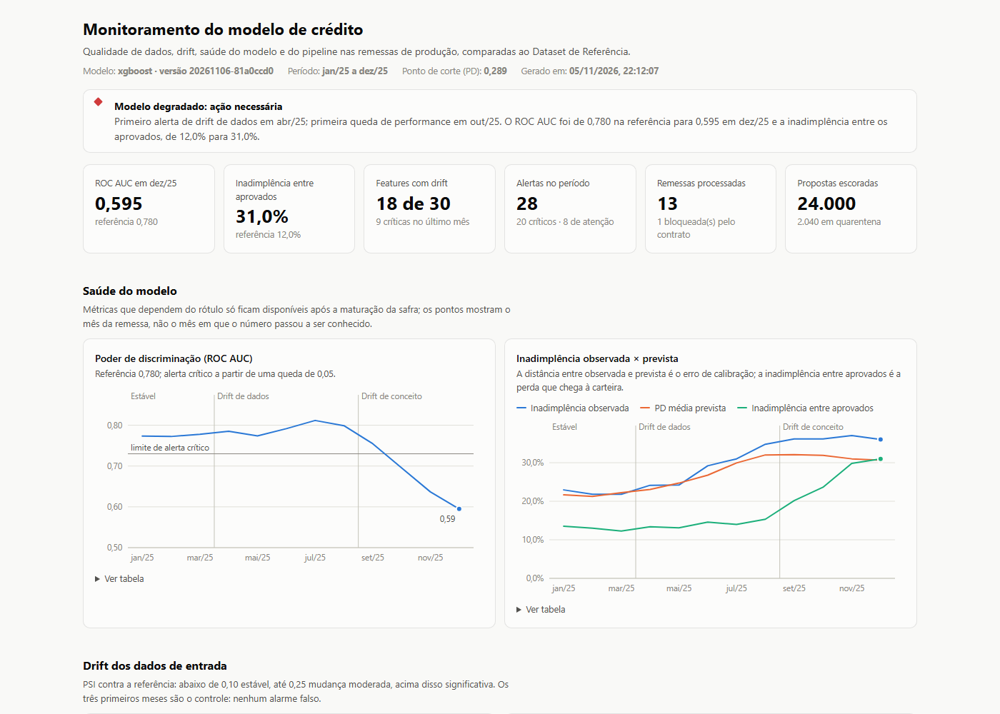

# Tech Challenge FIAP Fase 04 — Sustentação e Confiabilidade de um Modelo de Crédito


Camada de **sustentação e confiabilidade** de um modelo de *credit scoring* em produção: um contrato de dados que barra lotes inválidos antes da escoragem, a simulação de doze meses de degradação (drift de dados e de conceito), a detecção estatística dessa degradação, a observabilidade do pipeline e do modelo, e a governança do processo sob a LGPD, com análise causal do problema.

Repositório: <https://github.com/marcoaadc/tech-challenge-fase4-monitoramento-credito>

| Para ver | Abrir no navegador | Arquivo no repositório |
|---|---|---|
| **Dashboard de monitoramento** | **[abrir o dashboard](https://marcoaadc.github.io/tech-challenge-fase4-monitoramento-credito/reports/dashboard/index.html)** | [`reports/dashboard/index.html`](reports/dashboard/index.html) |
| Evidently — mar/2025, fase estável | [abrir o relatório](https://marcoaadc.github.io/tech-challenge-fase4-monitoramento-credito/reports/evidently/drift_2025-03.html) | [`drift_2025-03.html`](reports/evidently/drift_2025-03.html) |
| Evidently — ago/2025, drift de dados | [abrir o relatório](https://marcoaadc.github.io/tech-challenge-fase4-monitoramento-credito/reports/evidently/drift_2025-08.html) | [`drift_2025-08.html`](reports/evidently/drift_2025-08.html) |
| Evidently — dez/2025, drift de conceito | [abrir o relatório](https://marcoaadc.github.io/tech-challenge-fase4-monitoramento-credito/reports/evidently/drift_2025-12.html) | [`drift_2025-12.html`](reports/evidently/drift_2025-12.html) |
| Lote bloqueado pelo contrato | — | [`blocked_2025-07-r1.json`](reports/data_quality/blocked_2025-07-r1.json) |
| Causalidade, viés e remediação | — | [`analysis_report.md`](reports/analysis/analysis_report.md) |
| Alertas, métricas, eventos e log | — | [`alerts.jsonl`](reports/observability/alerts.jsonl) · [`metrics.prom`](reports/observability/metrics.prom) · [`pipeline_events.jsonl`](reports/observability/pipeline_events.jsonl) · [`pipeline_log.jsonl`](reports/observability/pipeline_log.jsonl) |
| O que foi rastreado no MLflow | — | [`mlflow_summary.json`](reports/observability/mlflow_summary.json) |

Os relatórios HTML são publicados pelo GitHub Pages a partir da branch `main`. Eles também são autocontidos: depois de clonar, basta abrir os arquivos no navegador.

**Sumário:** [1. O problema](#1-o-problema) · [2. Resultados](#2-resultados-em-uma-página) · [3. Requisitos do enunciado](#3-onde-está-cada-requisito-do-enunciado) · [4. Arquitetura](#4-arquitetura) · [5. Como executar](#5-como-executar) · [6. Contrato de dados](#6-etapa-1--validação-de-dados-e-contrato) · [7. Drift](#7-etapa-2--simulação-e-detecção-de-drift) · [8. Observabilidade](#8-etapa-3--observabilidade) · [9. Governança e LGPD](#9-etapa-4--governança-e-lgpd) · [10. Análise causal](#10-análise-causal-da-degradação) · [11. Decisões de design](#11-decisões-de-design) · [12. Qualidade](#12-qualidade-testes-lint-e-ci) · [13. Estrutura](#13-estrutura-do-repositório) · [14. Documentação](#14-documentação-adicional)

---

## 1. O problema

Uma fintech de concessão de crédito tem um modelo de *credit scoring* em produção. Com a inflação e a entrada de novos perfis de cliente, a diretoria suspeita que o modelo esteja decidindo mal — e ninguém sabe dizer se está, porque um modelo de crédito degrada **em silêncio**: ele continua respondendo, nenhum erro aparece no log. A perda só surge meses depois, na inadimplência da carteira aprovada.

Este projeto constrói o que faltava para responder a três perguntas, nesta ordem:

1. **O dado que chega é válido?** → contrato de dados (Etapa 1)
2. **O dado que chega ainda se parece com o do treino? O modelo ainda acerta?** → detecção de drift e de degradação (Etapas 2 e 3)
3. **O processo é defensável perante o titular e o regulador? Por que degradou e o que fazer?** → governança, LGPD e análise causal (Etapa 4)

**Dataset:** [*Default of Credit Card Clients*](https://doi.org/10.24432/C55S3H) (UCI, licença CC BY 4.0) — 30.000 clientes de cartão de crédito, com limite, seis meses de histórico de pagamento e o indicador de inadimplência no mês seguinte. São clientes que já têm cartão; aqui cada linha é tratada como uma proposta de concessão ou renovação de limite a ser escorada. Depois da limpeza são 29.965, divididos ao meio:

| | Linhas | Papel |
|---|---|---|
| **Dataset de Referência** | 14.982 (treino 8.989 · validação 2.996 · teste 2.997) | Única base usada para treinar e avaliar o modelo; linha de base do drift |
| **Dataset de Produção** | 12 remessas mensais de 2.000 propostas, amostradas dos outros 14.983 clientes | Onde a degradação é simulada; nunca visto no treino |

Termos usados ao longo do texto:

| Termo | Significado |
|---|---|
| PD | Probabilidade de inadimplência prevista pelo modelo (o score) |
| ROC AUC | Capacidade do modelo de ordenar bons e maus pagadores (0,5 = acaso; 1 = perfeito) |
| PSI | *Population Stability Index*: quanto a distribuição de uma variável mudou em relação à referência (abaixo de 0,10 estável; acima de 0,25 mudança significativa) |
| KS | Aparece em dois sentidos: o teste de Kolmogorov-Smirnov, que compara a distribuição de uma variável entre dois períodos, e o KS do modelo, que mede a separação entre os scores de bons e maus pagadores |
| Safra | O conjunto de propostas de um mês |
| Maturação do rótulo | Tempo até se saber se a proposta virou inadimplência (aqui, 2 meses) |
| p.p. | Pontos percentuais |
| Referência | Quando se fala em métricas "da referência", é a partição de teste do Dataset de Referência (2.997 clientes fora do treino e da seleção do modelo) |

## 2. Resultados em uma página



O cenário cobre doze meses de produção: três estáveis (controle), cinco com drift de dados e quatro com drift de conceito.

| Mês | Fase | Features com drift | PSI do score | Aprovação | ROC AUC | Inadimplência entre aprovados |
|---|---|---|---|---|---|---|
| referência | — | — | — | 74,4% | 0,780 | 12,0% |
| jan–mar | Estável | 0 | ≤ 0,01 | 75% a 77% | 0,772 a 0,778 | 12,3% a 13,5% |
| abr | Drift de dados | 3 | 0,01 | 72,8% | 0,785 | 13,4% |
| jun | Drift de dados | 9 | 0,07 | 66,2% | 0,792 | 14,6% |
| ago | Drift de dados | 22 | 0,28 | 55,1% | 0,799 | 15,3% |
| set | Drift de conceito | 20 | 0,26 | 55,0% | 0,755 | 20,2% |
| out | Drift de conceito | 20 | 0,27 | 54,6% | 0,696 | 23,6% |
| dez | Drift de conceito | 18 | 0,22 | 57,6% | **0,595** | **31,0%** |

O que o monitoramento mostra:

- **O contrato barra o dado ruim.** O arquivo original da UCI reprova (399 linhas com códigos fora do dicionário) e, em julho, uma remessa corrompida pela origem é bloqueada com sete regras violadas — 2.040 linhas em quarentena, nenhuma escorada.
- **Nenhum alarme falso.** Nos três meses de controle, nenhuma feature em drift e nenhum alerta.
- **O drift de dados é detectado em abril.** De abril a agosto, 22 das 30 features mudam. A ordenação do modelo se mantém (ROC AUC entre 0,77 e 0,81), mas o negócio muda: a aprovação cai de 76% para 55% e a inadimplência entre os aprovados sobe de 12,0% para 15,3%.
- **O drift de conceito é o que derruba o modelo**, e não aparece nos testes de entrada: a partir de setembro o número de features em drift até diminui, enquanto o AUC vai de 0,780 para 0,595 e a inadimplência entre os aprovados chega a 31,0%. O alerta de drift de dados de abril não antecipa essa queda; ela vem de outro mecanismo.
- **A degradação é vista com atraso.** O rótulo amadurece em dois meses: a queda de outubro só dispara alerta em dezembro.
- **A causa foi isolada.** Das quatro mudanças simuladas, o drift de conceito responde por −0,162 dos −0,169 de variação do AUC. As outras três, que explicam todas as features em alerta, somam −0,007 ([seção 10](#10-análise-causal-da-degradação)).
- **Retreinar não resolve.** Com os rótulos disponíveis na data da decisão, a melhor estratégia leva o AUC de 0,610 para 0,631. Mesmo um retreino com rótulos imediatos chegaria só a 0,646: a maior parte da perda não se recupera com modelo, e sim com política de crédito.

Foram **28 alertas** emitidos para as doze remessas (20 críticos), no máximo um alerta de drift de dados por remessa. Seis deles, que dependem de rótulo, só seriam vistos em janeiro e fevereiro de 2026.

## 3. Onde está cada requisito do enunciado

| Requisito | Onde está atendido |
|---|---|
| **Etapa 1** — classificador base treinado em dataset limpo | [`pipelines/train.py`](src/creditwatch/pipelines/train.py), [`models/`](models/), [Model Card](docs/model_card.md) |
| **Etapa 1** — contrato de dados com regras estritas | [`contracts/`](src/creditwatch/contracts/) — 13 regras bloqueantes e 1 aviso ([§6](#6-etapa-1--validação-de-dados-e-contrato)) |
| **Etapa 1** — lote com erros bloqueado | `make demo-bad-batch`; [`blocked_2025-07-r1.json`](reports/data_quality/blocked_2025-07-r1.json); [docs/contrato_de_dados.md](docs/contrato_de_dados.md) |
| **Etapa 2** — Dataset de Produção com distribuição alterada em ao menos duas variáveis | [`simulation/`](src/creditwatch/simulation/) — 4 mecanismos, 18 features em drift em dezembro ([§7](#7-etapa-2--simulação-e-detecção-de-drift)) |
| **Etapa 2** — predições para o novo dataset | Estágio `score` de [`monitor.py`](src/creditwatch/pipelines/monitor.py); score médio e taxa de aprovação de cada remessa em [`timeline.csv`](reports/monitoring/timeline.csv). Os arquivos de predição por proposta ficam fora do repositório, como os de uma operação real |
| **Etapa 2** — Evidently comparando referência e produção | [`evidently_report.py`](src/creditwatch/drift/evidently_report.py), relatórios HTML em [`reports/evidently/`](reports/evidently/) |
| **Etapa 2** — testes estatísticos (PSI, KS) apontando as features | [`drift/`](src/creditwatch/drift/), [`feature_drift.csv`](reports/monitoring/feature_drift.csv), [docs/drift.md](docs/drift.md) |
| **Etapa 3** — logs e métricas centralizados | [`observability/`](src/creditwatch/observability/); [`pipeline_log.jsonl`](reports/observability/pipeline_log.jsonl), [`pipeline_events.jsonl`](reports/observability/pipeline_events.jsonl), [`metrics.prom`](reports/observability/metrics.prom) |
| **Etapa 3** — rastreamento ou dashboard | MLflow, com resumo em [`mlflow_summary.json`](reports/observability/mlflow_summary.json), **e** [dashboard](reports/dashboard/index.html) |
| **Etapa 3** — métricas de saúde documentadas | [§8](#8-etapa-3--observabilidade) e [docs/observabilidade.md](docs/observabilidade.md), seção 4 |
| **Etapa 4** — como a PII foi tratada, base legal e retenção | [§9.2 a §9.6](#9-etapa-4--governança-e-lgpd) |
| **Etapa 4** — mitigação de vieses | [§9.7](#97-viés-prevenção-auditoria-e-plano-de-mitigação) |
| **Etapa 4** — análise causal | [§10](#10-análise-causal-da-degradação), [`analysis_report.md`](reports/analysis/analysis_report.md) |
| Separação entre referência e produção | [`split.py`](src/creditwatch/data/split.py), [`data/README.md`](data/README.md) |
| Pelo menos 3 regras rígidas de qualidade | `DQ-01` (nulos), `DQ-02` (idade), `DQ-03` (limite) e outras dez |
| Relatório estatístico da mudança de distribuição | Dashboard, relatórios do Evidently, [`feature_drift.csv`](reports/monitoring/feature_drift.csv) |
| Dashboards ou relatórios HTML | [Dashboard](https://marcoaadc.github.io/tech-challenge-fase4-monitoramento-credito/reports/dashboard/index.html) e três relatórios do Evidently, versionados e publicados |
| Bibliotecas: scikit-learn, XGBoost, Pandera, Evidently, MLflow, prometheus-client | [`pyproject.toml`](pyproject.toml) |
| Dataset financeiro binário com 5.000 amostras ou mais | 30.000 clientes (UCI) |
| Histórico de commits semântico | Conventional Commits + [CHANGELOG](CHANGELOG.md) |

## 4. Arquitetura

```
                        ┌─────────────────── Dataset de Referência ───────────────────┐
 UCI (CSV, SHA-256) ──▶ ingest ──▶ contrato ✗ bruto reprova ──▶ limpeza ──▶ contrato ✓ ──▶ referência ──▶ train
                                                                                  │                        │
                                                                                  ▼                        ▼
                                                                    metade reservada (produção)     model.joblib
                                                                                  │                 metadata.json
                                                                                  ▼                 (SHA-256, MLflow)
                        ┌──────────────────── Dataset de Produção ────────────────────┐                   │
                        │ simulate: 12 remessas mensais (inflação, aperto financeiro, │                   │
                        │ novos perfis, drift de conceito) + 1 remessa corrompida     │                   │
                        └──────────────────────────────┬──────────────────────────────┘                   │
                                                       ▼                                                  │
 monitor, por remessa:  read_batch ──▶ contract ──▶ score ◀───────────────────────────────────────────────┘
                                          │           │
                              ✗ quarentena + alerta   ├──▶ drift       PSI · KS · qui² contra a referência
                              (nada é escorado)       ├──▶ performance AUC · KS · calibração (rótulo maduro)
                                                      └──▶ evidently   relatório HTML nos checkpoints
                                                       │
            ┌──────────────────────────────────────────┼─────────────────────────────────────────┐
            ▼                        ▼                 ▼                    ▼                    ▼
   pipeline_events.jsonl       alerts.jsonl       metrics.prom           MLflow          pipeline_log.jsonl
   (saúde dos estágios)     (6 famílias)        (Prometheus)      (treino + série        (JSON, run_id)
            │                        │                 │          temporal por remessa)
            └────────────────────────┴────────┬────────┘
                                              ▼
 analyze: causalidade · viés · remediação ──▶ dashboard: reports/dashboard/index.html
```

Cada estágio é uma função `run_*` em [`src/creditwatch/pipelines/`](src/creditwatch/pipelines/), chamada pela CLI, pelo orquestrador `run_all` e pelos testes.

## 5. Como executar

**Requisitos:** Python 3.10 a 3.12 e [Poetry](https://python-poetry.org/) ≥ 2.0. O `make` é opcional (no Windows, use Git Bash); cada alvo tem um comando Poetry equivalente.

```bash
git clone https://github.com/marcoaadc/tech-challenge-fase4-monitoramento-credito.git
cd tech-challenge-fase4-monitoramento-credito
poetry install                  # ou: make install
cp .env.example .env            # opcional; todos os valores têm defaults
```

O repositório já traz os dados, o modelo e os relatórios da execução de referência. Para refazer tudo:

```bash
make pipeline
# equivalente:
CREDITWATCH_MLFLOW_TRACKING_URI=sqlite:///mlflow.db poetry run python -m creditwatch.pipelines.run_all
```

Leva de um a dois minutos e executa, em sequência:

| Estágio | Comando | O que faz | Saída principal |
|---|---|---|---|
| `ingest` | `python -m creditwatch.pipelines.ingest` | Confere o SHA-256 do bruto, valida, limpa, exige o contrato e separa referência × produção | `data/reference/`, `reports/data_quality/` |
| `train` | `python -m creditwatch.pipelines.train` | Treina Regressão Logística e XGBoost, escolhe por ROC AUC de validação | `models/`, `reports/model/` |
| `simulate` | `python -m creditwatch.pipelines.simulate` | Gera as remessas mensais e a remessa corrompida | `data/production/` |
| `monitor` | `python -m creditwatch.pipelines.monitor` | Contrato, escoragem, drift, performance, alertas, Evidently | `reports/monitoring/`, `reports/observability/`, `reports/evidently/` |
| `analyze` | `python -m creditwatch.pipelines.analyze` | Atribuição causal, varredura de calibração, auditoria de viés, backtest de remediação | `reports/analysis/` |
| `dashboard` | `python -m creditwatch.pipelines.dashboard` | Consolida tudo em um HTML | `reports/dashboard/index.html` |

**Demonstração do contrato bloqueando um lote ruim** (o comando termina com código de saída 1):

```bash
make demo-bad-batch
# equivalente:
poetry run python -m creditwatch.pipelines.validate data/production/batch_2025-07_remessa1_corrompida.parquet
```

**Rastreamento e relatórios:**

```bash
make mlflow-ui        # MLflow em http://127.0.0.1:5000
make serve-reports    # dashboard em http://127.0.0.1:8000/dashboard/
make evidently-all    # relatório do Evidently para os 12 meses (o padrão gera 3 checkpoints)
```

## 6. Etapa 1 — Validação de dados e contrato

Contrato em [Pandera](https://pandera.readthedocs.io/), com um catálogo de regras de identificador estável ([`contracts/`](src/creditwatch/contracts/)). Detalhes em [docs/contrato_de_dados.md](docs/contrato_de_dados.md).

| Regra | O que exige |
|---|---|
| `DQ-01` Completude | Nenhuma coluna obrigatória com valor nulo |
| `DQ-02` Idade válida | Idade entre 18 e 100 |
| `DQ-03` Limite de crédito | Limite entre 1.000 e 1.000.000 (teto da política) |
| `DQ-04` Unicidade | `customer_id` sem repetição no lote |
| `DQ-05` Domínio dos categóricos | `sex`, `education`, `marriage` restritos ao dicionário |
| `DQ-06` a `DQ-08` | Status de pagamento entre −2 e 8, pagamentos não negativos, faturas em faixa plausível |
| `DQ-09` Esquema estrito | Todas as colunas presentes e **nenhuma coluna extra** (bloqueia PII enviada por engano) |
| `DQ-10` Tipos | Colunas numéricas inteiras: texto e valores com fração reprovam, em vez de serem truncados |
| `DQ-11` a `DQ-13` | Volume mínimo, rótulo binário, mês de referência único |
| `DQ-W01` (aviso) | Menos de 60% da carteira sem consumo no mês |

Quando um lote reprova, um relatório diz qual regra falhou e em quantas linhas, uma cópia vai para a quarentena (sem as colunas que não estão no contrato), um alerta crítico é emitido e **nada é escorado**:

```
Contrato: credit_batch | Lote: batch_2025-07_remessa1_corrompida | 2040 linhas x 26 colunas
Resultado: BLOQUEADO
Linhas com pelo menos uma falha: 247

Regra    Falhas  Titulo                     Colunas
DQ-01        60  Completude                 limit_bal
DQ-02        40  Idade válida               age
DQ-03        21  Limite de crédito          limit_bal
DQ-04        80  Unicidade                  customer_id
DQ-05        40  Domínio dos categóricos    education, sex
DQ-07        20  Pagamentos não negativos   pay_amt_1
DQ-09         1  Esquema estrito            cpf
```

O contrato trata de valores **inválidos**. Mudança de distribuição de valores válidos não reprova o lote: é assunto da detecção de drift. O modelo baseline (XGBoost, ROC AUC 0,780 e KS 0,445 no teste) está descrito no [Model Card](docs/model_card.md).

## 7. Etapa 2 — Simulação e detecção de drift

Quatro mecanismos independentes alteram as remessas de produção ([`simulation/`](src/creditwatch/simulation/)); detalhes e tabelas completas em [docs/drift.md](docs/drift.md).

| Mecanismo | Tipo | O que muda | Variáveis afetadas |
|---|---|---|---|
| Inflação | drift de dados | Faturas até 70% maiores em termos nominais; pagamentos acompanham só 35% disso | `bill_amt_*`, `pay_amt_*`, utilização, razão de pagamento |
| Aperto financeiro | drift de dados | Mais clientes com atraso recente | `pay_status_*`, `max_delay`, `months_delayed` |
| Novos perfis | drift de dados | Clientes mais jovens e com limite menor | `age`, `limit_bal` |
| Drift de conceito | drift de conceito | Bons pagadores com utilização alta do limite passam a inadimplir; parte dos inadimplentes é curada | nenhuma feature — só a relação entre features e inadimplência |

Cada remessa é comparada com a referência em 30 features: PSI em todas, Kolmogorov-Smirnov nas numéricas e qui-quadrado nas categóricas ([`drift/`](src/creditwatch/drift/)). A severidade é decidida pelo **tamanho do efeito** (PSI ≥ 0,10 atenção, ≥ 0,25 crítico), porque com milhares de linhas o p-valor acusa qualquer diferença: em dezembro, 28 das 30 features têm p < 0,001 ([ADR 002](docs/adr/002-psi-como-criterio-de-drift.md)).

As oito features mais afetadas em dezembro, das 18 em drift (PSI do detector próprio; lista completa em [docs/drift.md](docs/drift.md)):

| Feature | PSI | Teste | Tamanho do efeito | Situação |
|---|---|---|---|---|
| `utilization_1` | 0,813 | KS | 0,413 | crítico |
| `bill_trend` | 0,605 | KS | 0,331 | crítico |
| `payment_ratio_1` | 0,504 | KS | 0,248 | crítico |
| `utilization_avg` | 0,491 | KS | 0,303 | crítico |
| `payment_ratio_avg` | 0,392 | KS | 0,195 | crítico |
| `pay_status_2` | 0,274 | qui² | 0,213 | crítico |
| `pay_status_1` | 0,263 | qui² | 0,218 | crítico |
| `limit_bal` | 0,231 | KS | 0,209 | atenção |

O tamanho do efeito é o D do KS nas numéricas e a distância de variação total nas categóricas (a fração da carteira que mudou de categoria); nenhum dos dois depende do tamanho do lote.

O **Evidently AI** gera o relatório HTML de cada checkpoint, também com PSI e os mesmos limiares. Os valores de PSI dele não são os da tabela acima: ele monta as faixas de outra forma e compara com as partições de validação e teste (para que o score e a qualidade da classificação sejam honestos), enquanto o detector próprio compara com a referência inteira. Em dezembro o Evidently aponta 16 de 31 colunas (ele inclui o score) e o detector próprio, 18 de 30. O que os dois precisam concordar é *quais* variáveis mudaram, e concordam: tudo o que o Evidently aponta o detector próprio também aponta ([`tests/test_integrations.py`](tests/test_integrations.py)).

## 8. Etapa 3 — Observabilidade

Detalhes, catálogo completo de métricas e exemplos em [docs/observabilidade.md](docs/observabilidade.md).

| O que | Onde | Como |
|---|---|---|
| **Logs centralizados** | [`pipeline_log.jsonl`](reports/observability/pipeline_log.jsonl) | Todos os estágios no mesmo arquivo JSON Lines, com o `run_id` da execução; nunca valores de linhas. O log da execução de referência fica versionado |
| **Eventos de estágio** | [`pipeline_events.jsonl`](reports/observability/pipeline_events.jsonl) | Um evento por estágio: status (`success`, `blocked`, `failed`), duração, tempo de CPU, linhas de entrada e de saída |
| **Alertas** | [`alerts.jsonl`](reports/observability/alerts.jsonl) | Seis famílias: qualidade de dados, drift de dados, drift de predição, drift do alvo, performance e calibração |
| **Rastreamento** | MLflow (`sqlite:///mlflow.db`) | Experimento de treino com o modelo registrado; experimento de monitoramento com a série temporal de cada métrica e um run por remessa. O banco não é versionado; [`mlflow_summary.json`](reports/observability/mlflow_summary.json) lista o que ele contém |
| **Métricas** | [`metrics.prom`](reports/observability/metrics.prom) | Formato Prometheus (textfile collector ou Pushgateway), para integrar à stack da Fase 3 |
| **Dashboard** | [`reports/dashboard/index.html`](reports/dashboard/index.html) | HTML único, sem dependência externa, com tabela equivalente para cada gráfico |

Métricas de saúde escolhidas:

| Grupo | Métricas | Disponível |
|---|---|---|
| Pipeline | Execuções de estágio por resultado, duração e tempo de CPU por estágio, remessas escoradas e bloqueadas, linhas escoradas e em quarentena, violações por regra, instante da última execução | a cada execução |
| Drift | PSI por feature, número e fração de features com drift, PSI do score, taxa de aprovação | no dia da escoragem |
| Modelo | ROC AUC, KS, calibração, taxa de inadimplência, inadimplência entre aprovados | após a maturação do rótulo (2 meses) |
| Alertas | Contagem por família e severidade | a cada execução |

Na execução de referência: 13 remessas, 12 escoradas (24.000 propostas) e 1 bloqueada; 66 execuções de estágio no monitoramento, 65 com sucesso, 1 bloqueio e nenhuma falha.

**Sobre infraestrutura.** O pipeline é um job em lote, sem serviço no ar. O que se mede de infraestrutura é o que faz sentido para um job: duração e tempo de CPU de cada estágio, falhas, volume e a data da última execução (para alertar quando o job deixa de rodar). Métricas de máquina (memória, disco, rede) ficam com o orquestrador ou com o node_exporter do ambiente onde o job for agendado. O que fazer diante de cada alerta está no [runbook](docs/runbook.md).

## 9. Etapa 4 — Governança e LGPD

Plano de proteção de dados do projeto. É um desenho acadêmico, baseado na Lei 13.709/2018 (LGPD) e na legislação de crédito, e não substitui a análise do jurídico e do encarregado de uma operação real.

### 9.1 O que é real e o que é hipotético

- **Real, neste repositório:** os dados são públicos e já chegam desidentificados (clientes de um banco de Taiwan em 2005, sem nome, documento ou contato). Nenhum dado pessoal de pessoa identificável é tratado aqui. As medidas técnicas da seção 9.3 existem no código e são testadas.
- **Hipotético:** os papéis, as bases legais, os direitos e os prazos abaixo descrevem como a fintech do enunciado trataria os dados dos seus clientes se este pipeline estivesse em produção. A linguagem de "titular" e "controlador" se refere a essa operação.

| Papel | Quem | Responsabilidade |
|---|---|---|
| Controlador | A fintech | Decide a finalidade (análise de risco de crédito) e responde pelo tratamento |
| Operador | Provedores de infraestrutura | Tratam os dados conforme as instruções do controlador. Birôs de crédito, quando fornecem dados, costumam ser controladores dos seus próprios bancos |
| Encarregado (DPO) | Indicado pelo controlador (art. 41) | Canal com os titulares e com a ANPD; recebe os alertas de privacidade do [runbook](docs/runbook.md) |
| Comitê de modelos | Risco, dados, jurídico e encarregado | Aprova a promoção de modelos e as mudanças de política |

### 9.2 Inventário de dados

| Dado | Classificação | Finalidade | Entra no modelo |
|---|---|---|---|
| `customer_id` | Identificador da proposta, gerado por remessa (mês + sequencial). Não liga a mesma pessoa entre meses | Unicidade do lote e ligação entre proposta, decisão e rótulo | não |
| `limit_bal`, `pay_status_*`, `bill_amt_*`, `pay_amt_*` | Dado pessoal financeiro | Estimar o risco de inadimplência | sim |
| `age` | Dado pessoal | Validar a capacidade civil (≥ 18 anos), auditar viés e acompanhar o perfil da carteira | não |
| `sex`, `marriage`, `education` | Dado pessoal com potencial discriminatório | Auditar viés e acompanhar o perfil da carteira (drift de população), sempre de forma agregada | não |
| `default` | Dado pessoal financeiro (rótulo) | Treinar o modelo e medir o desempenho | alvo |
| `score`, `approved` | Dado pessoal derivado do tratamento (art. 5º, I) | Decisão de crédito | saída |

Não há dados pessoais sensíveis na definição do art. 5º, II. Sexo, idade, estado civil e escolaridade não são "sensíveis" nessa definição, mas podem servir a discriminação e por isso recebem tratamento reforçado.

### 9.3 Como os dados pessoais foram tratados neste projeto

Medidas de *privacy by design* e *by default* (art. 46, § 2º) que existem no código:

| Princípio (art. 6º) | Medida | Onde |
|---|---|---|
| Necessidade (minimização) | O contrato é **estrito**: qualquer coluna fora do esquema reprova o lote. Um `cpf` enviado por engano é bloqueado antes de chegar ao modelo | [`credit_contract.py`](src/creditwatch/contracts/credit_contract.py), regra `DQ-09` |
| Necessidade | A cópia em quarentena **não grava** as colunas fora do contrato: o dado enviado por engano não ganha uma segunda cópia. O relatório registra só o nome da coluna | [`gate.py`](src/creditwatch/contracts/gate.py), [`test_contract.py`](tests/test_contract.py) |
| Necessidade | O modelo usa só as 26 variáveis financeiras; um teste garante que nenhum atributo sociodemográfico entra | [`schema.py`](src/creditwatch/data/schema.py), [ADR 004](docs/adr/004-atributos-protegidos-fora-do-modelo.md) |
| Finalidade | Atributos sociodemográficos têm uso declarado: validação de maioridade, auditoria de viés e perfil agregado da carteira | [`fairness.py`](src/creditwatch/analysis/fairness.py), [`detector.py`](src/creditwatch/drift/detector.py) |
| Segurança | Logs e eventos registram contagens e nomes de regras, nunca valores de linhas | [`observability/`](src/creditwatch/observability/) |
| Segurança | O relatório de falha não registra valores de colunas inesperadas nem identificadores de cliente; um teste confirma que nenhum CPF vaza | [`gate.py`](src/creditwatch/contracts/gate.py) |
| Segurança | Quarentena e predições por proposta ficam fora do repositório (`.gitignore`) | `data/quarantine/`, `data/predictions/` |
| Prevenção | Os CPFs do lote de demonstração são fictícios e inválidos por construção: nunca reproduzem o documento de uma pessoa real | [`corruption.py`](src/creditwatch/simulation/corruption.py) |
| Qualidade dos dados | Nenhum lote é escorado sem passar no contrato; o treino só usa o dataset limpo e validado, com o hash do arquivo de origem conferido | [`ingest.py`](src/creditwatch/pipelines/ingest.py), [`source.py`](src/creditwatch/data/source.py) |
| Responsabilização | Cada predição guarda a versão do modelo; `metadata.json` guarda o SHA-256 do dataset e do artefato, hiperparâmetros e métricas; cada execução tem um `run_id` | [`registry.py`](src/creditwatch/model/registry.py) |
| Não discriminação | Auditoria de viés a cada execução, por sexo, idade, escolaridade e estado civil | [§9.7](#97-viés-prevenção-auditoria-e-plano-de-mitigação) |

### 9.4 Base legal

| Tratamento | Base legal | Fundamento |
|---|---|---|
| Análise de risco e cálculo do score | **Proteção do crédito** (LGPD, art. 7º, X) | Base específica para a atividade. O STJ reconheceu o *credit scoring* como prática lícita que dispensa o consentimento, garantido ao consumidor o direito a esclarecimentos sobre os dados considerados e as suas fontes (Tema 710, REsp 1.419.697/RS; Súmula 550, de 2015, anterior à LGPD) |
| Processamento da proposta | Procedimentos preliminares a contrato, a pedido do titular (art. 7º, V) | O cliente solicita o crédito |
| Treino, validação e retreino do modelo | Proteção do crédito (art. 7º, X) | O modelo é o instrumento da análise de risco; o treino usa apenas os dados da própria análise (finalidade e necessidade, art. 6º, I e III) |
| Guarda de registros e gestão de risco | Cumprimento de obrigação legal ou regulatória (art. 7º, II) | Regras do CMN e do Banco Central sobre gerenciamento de risco de crédito, como a Resolução CMN 4.557/2017 |
| Defesa em contestações e processos | Exercício regular de direitos (art. 7º, VI) | Guarda do que for necessário para responder a uma contestação da decisão |
| Monitoramento de drift e auditoria de viés | Legítimo interesse (art. 7º, IX, e art. 10) | Ver o resumo do teste de balanceamento abaixo |

Resumo do teste de balanceamento do legítimo interesse (o controlador precisa conseguir demonstrá-lo; ver o guia de legítimo interesse da ANPD, de 2024):

- **Finalidade legítima:** detectar que o modelo passou a errar ou a tratar grupos de forma desigual.
- **Necessidade:** usa apenas dados já tratados para a decisão; os atributos sociodemográficos entram só em estatísticas agregadas.
- **Balanceamento:** não gera decisão sobre nenhum indivíduo, beneficia o próprio titular (menos negativas indevidas) e tem salvaguardas: acesso restrito, sem registro individual em logs, grupos pequenos fora dos relatórios comparativos.

O **consentimento não é a base** desse tratamento: além de dispensado pelo STJ para o *scoring*, ele pode ser revogado a qualquer momento, o que o torna inadequado para uma análise de risco. Limites que continuam valendo:

- **Lei 12.414/2011 (Cadastro Positivo), art. 3º, § 3º:** proíbe a anotação de informações excessivas e de informações sensíveis (origem social e étnica, saúde, informação genética, orientação sexual, convicções políticas, religiosas e filosóficas) nos bancos de dados de crédito. O STJ aplicou os mesmos limites ao cálculo do score. O modelo não usa nenhuma delas.
- **Código de Defesa do Consumidor, art. 43:** direito de acesso às informações e limite de cinco anos para informações negativas.
- **LGPD, art. 6º, IX:** vedação de tratamento para fins discriminatórios ilícitos ou abusivos.

### 9.5 Decisão automatizada e direitos do titular

A decisão de crédito é automatizada. O titular pode pedir a sua revisão e informações claras sobre os critérios usados, observados os segredos comercial e industrial (LGPD, art. 20; Lei 12.414/2011, art. 5º, IV e VI).

O que existe no código:

- **Rastreabilidade:** cada predição registra a versão do modelo, e os metadados levam ao dataset e ao código que o produziram. Um modelo adulterado não carrega (verificação de SHA-256).
- **Modelo explicável por desenho:** as entradas são só comportamento financeiro, e três variáveis de histórico de atraso concentram 62% da importância.

O que é processo previsto, e não está implementado:

- **Explicação por decisão:** informar ao titular os principais fatores da sua negativa. A importância medida hoje é global; uma explicação individual exigiria calcular a contribuição de cada variável por proposta.
- **Revisão humana:** a LGPD garante a revisão, não exige que ela seja feita por uma pessoa. Aqui a escolha de governança é encaminhar a um analista as negativas contestadas e as propostas perto do ponto de corte ([runbook](docs/runbook.md), seções 4 e 6).
- **Localizar os dados de um titular:** os identificadores deste pipeline são por remessa. Atender a um pedido de acesso ou correção (art. 18) depende da chave de correspondência mantida pelo sistema de origem.
- **Oposição e eliminação:** o titular pode se opor a um tratamento feito sem consentimento se ele descumprir a lei (art. 18, § 2º). A eliminação a pedido é limitada enquanto durar a base legal que justifica a guarda (art. 16).

### 9.6 Plano de retenção

Uma regra por tipo de registro. As remessas de produção e as predições deste pipeline são os registros de "proposta e decisão" das duas primeiras linhas.

| Registro | Prazo | Fundamento | Ao fim do prazo |
|---|---|---|---|
| Proposta aprovada e sua decisão (dados, score, versão do modelo) | Vigência do contrato + 5 anos | Obrigação regulatória (art. 16, I) e exercício de direitos (art. 7º, VI); prescrição de cobrança de dívidas líquidas (Código Civil, art. 206, § 5º, I) | Eliminação ou anonimização |
| Proposta negada e sua decisão | 12 meses; mais tempo só enquanto durar uma contestação ou processo | Atender ao direito de revisão (art. 20) e à defesa (art. 7º, VI); sem relação contratual, não há motivo para guardar mais | Eliminação |
| Informação de inadimplência ligada ao cliente | No máximo 5 anos | CDC, art. 43, § 1º | Eliminação do vínculo com o cliente |
| Dataset de Referência (treino) | Enquanto o modelo estiver em uso + 5 anos, sem identificadores diretos; registros de inadimplência com mais de 5 anos só anonimizados | Reprodutibilidade e auditoria da decisão automatizada; uso exclusivo do controlador, com dados anonimizados (art. 16, IV) | Eliminação |
| **Quarentena** | **30 dias** | Só o tempo de a origem corrigir e reenviar. Colunas fora do contrato nunca são gravadas | Eliminação |
| Logs e eventos do pipeline | 12 meses | Diagnóstico operacional; não contêm dados pessoais | Eliminação |
| Relatórios de monitoramento | 5 anos | Agregados, sem dados pessoais; evidência de governança | Arquivamento |

O repositório implementa a parte estrutural do plano: remessas particionadas por mês, quarentena e predições fora do versionamento, descarte das colunas fora do contrato e limpeza por `make clean`. A eliminação automática por prazo seria tarefa de um orquestrador em produção e não está implementada.

### 9.7 Viés: prevenção, auditoria e plano de mitigação

**Prevenção (aplicada).** Sexo, idade, estado civil e escolaridade não são preditores. A exclusão não custa desempenho: treinando o mesmo XGBoost com e sem eles, em três seeds, o ROC AUC de teste é 0,7806 com e 0,7809 sem (na validação, 0,7782 contra 0,7754).

**Auditoria (aplicada, a cada execução).** Retirar o atributo não retira o seu efeito, porque as variáveis financeiras podem servir de *proxy*. Mede-se:

- **impacto desigual:** taxa de aprovação do grupo dividida pela do grupo mais aprovado, com intervalo de 95%. A referência usada é a regra dos quatro quintos (abaixo de 0,80), uma heurística da agência americana de igualdade no emprego, sem status legal no Brasil, adotada aqui como critério de triagem;
- **diferença de oportunidade:** quanto a taxa de aprovação entre *bons pagadores* do grupo fica abaixo da do grupo mais favorecido — negar crédito a quem pagaria é o erro que mais prejudica o titular.

Grupo menos aprovado de cada atributo:

| Atributo | Referência | Drift de dados | Drift de conceito |
|---|---|---|---|
| Sexo (masculino) | 0,94 (0,91 a 0,97) | 0,95 (0,92 a 0,98) | 0,91 (0,88 a 0,95) |
| Faixa etária | 0,95 (0,92 a 0,98) — 18–29 | 0,91 (0,88 a 0,94) — 18–29 | 0,91 (0,82 a 1,01) — 50+ |
| Escolaridade (ensino médio) | 0,87 (0,83 a 0,92) | **0,83 (0,80 a 0,87)** | **0,82 (0,77 a 0,87)** |
| Estado civil | 0,98 (0,95 a 1,01) | 1,00 (0,97 a 1,03) | 1,00 (0,96 a 1,04) |

Leitura:

- Nenhum grupo fica abaixo de 0,80 na estimativa pontual. Para escolaridade, o intervalo cruza o limite nos dois períodos de drift: o resultado é **inconclusivo**, não um atestado de conformidade.
- A diferença de oportunidade é a medida menos favorável: entre bons pagadores, o grupo "ensino médio" é aprovado 9,0 p.p. menos que o grupo mais favorecido na referência e 13,2 p.p. menos no drift de conceito.
- A disparidade existe desde o treino. Ela varia entre os períodos porque a composição da carteira muda (o aperto financeiro atinge os grupos de forma desigual e o modelo reage a atrasos); isso não demonstra que a degradação do modelo, em si, seja desigual.
- Grupos com menos de 100 clientes ou de 2% da amostra do período (a categoria "outros" de escolaridade e de estado civil) aparecem no relatório, mas ficam fora da comparação: a taxa de um grupo pequeno é ruidosa e, se ele virar o grupo de referência, fabrica impacto adverso nos demais.

**Mitigação (plano, não aplicada).** Nenhuma técnica de mitigação foi aplicada neste projeto; o que existe é o gatilho e o caminho. Se um grupo cruzar o limite com o intervalo inteiro abaixo de 0,80, ou se a diferença de oportunidade passar de 10 p.p.:

1. investigar quais variáveis financeiras separam o grupo dos demais (*proxies*);
2. encaminhar para revisão humana as negativas do grupo perto do ponto de corte;
3. avaliar no comitê as opções do [ADR 004](docs/adr/004-atributos-protegidos-fora-do-modelo.md): rever features, reponderar o treino ou ajustar o corte — a última só se a análise jurídica admitir usar o atributo na decisão;
4. registrar a decisão e repetir a auditoria no desafiante antes de promovê-lo ([runbook](docs/runbook.md), seção 6).

Pelo segundo critério, o grupo "ensino médio" já pede a investigação do passo 1 (13,2 p.p. no drift de conceito).

### 9.8 Riscos e salvaguardas

| Risco para o titular | Salvaguarda |
|---|---|
| Decisão tomada com dado inválido | Contrato bloqueante antes da escoragem |
| Negativa indevida por modelo degradado | Monitoramento de drift e de performance, alertas e runbook com contenção |
| Discriminação indireta | Atributos sociodemográficos fora do modelo e auditoria de viés recorrente |
| Exposição de dados pessoais | Esquema estrito, logs sem dados de linha, quarentena sem colunas fora do contrato, predições fora do repositório |
| Decisão que não se consegue explicar | Versão do modelo em cada predição, metadados com hashes, modelo baseado só em comportamento financeiro |
| Adulteração do modelo ou dos dados | SHA-256 do artefato conferido a cada carga e do dataset a cada ingestão |

Em uma operação real, este tratamento — decisão automatizada com efeito relevante sobre o titular — justifica ter pronto um Relatório de Impacto à Proteção de Dados Pessoais, que a ANPD pode exigir (art. 38; art. 10, § 3º, quando a base é o legítimo interesse), e um plano de resposta a incidentes (art. 50, § 2º, I, g), com a comunicação prevista no art. 48.

## 10. Análise causal da degradação

A detecção diz *que* o modelo piorou; governar exige saber *por quê*. Código em [`analysis/causal.py`](src/creditwatch/analysis/causal.py), resultados em [`analysis_report.md`](reports/analysis/analysis_report.md).

### 10.1 Modelo causal


Três caminhos passam pelas features e portanto pelo score: o modelo os enxerga. O quarto — a mudança de comportamento — vai direto para a inadimplência sem tocar em nenhuma entrada.

### 10.2 O que causou a queda (intervenção)

Como o cenário é um modelo causal conhecido, cada mecanismo pode ser ligado e desligado isoladamente (uma intervenção, o operador *do* da literatura de causalidade). As 16 combinações dos quatro mecanismos foram avaliadas no plano de dezembro, em lotes de 2.000 propostas como os de produção, e repetidas com 5 seeds. A variação de cada métrica foi repartida entre os mecanismos por **valores de Shapley**: a contribuição média de cada um sobre todas as ordens em que eles podem ser ligados, de modo que as parcelas somam exatamente o efeito total.

| Mecanismo | ROC AUC | Inadimplência entre aprovados | Taxa de aprovação | Features com drift |
|---|---|---|---|---|
| Inflação | −0,015 ± 0,005 | +2,0 p.p. | +2,0 p.p. | +6,2 |
| Aperto financeiro | +0,022 ± 0,007 | +0,2 p.p. | −17,8 p.p. | +10,4 |
| Novos perfis | −0,014 ± 0,006 | +2,0 p.p. | −4,1 p.p. | +3,3 |
| **Drift de conceito** | **−0,162 ± 0,008** | **+13,3 p.p.** | 0,0 p.p. | **0,0** |
| Efeito total | −0,169 | +17,5 p.p. | −19,9 p.p. | +20,0 |

Média ± desvio-padrão entre as seeds. Sem nenhum mecanismo o ROC AUC é 0,774; com todos, 0,606 (na remessa de dezembro, que é uma dessas cinco amostras, 0,595).

Cada coluna tem um responsável diferente:

- a **queda de AUC** e o salto da **inadimplência entre aprovados** vêm do drift de conceito;
- a **queda da aprovação** vem do aperto financeiro, que traz mais clientes com atraso;
- as **features em alerta** vêm dos três mecanismos de drift de dados.

Quem priorizasse a investigação pelo volume de alarmes procuraria no lugar errado. Uma ressalva: o drift de conceito explicar zero features é verdade por construção — ele só altera o rótulo e o detector só olha features. O que a tabela acrescenta é a medida do outro lado: os mecanismos que disparam todos os alarmes custam, somados, −0,007 de AUC.

O aperto financeiro até *melhora* o AUC: ao trazer mais clientes com atraso, torna a população mais fácil de ordenar, embora mais arriscada.

### 10.3 Onde procurar, só com os dados

Em produção não há como desligar a inflação nem se conhece a regra da mudança. O que se pode fazer, quando o rótulo amadurece, é procurar onde o erro do modelo se concentrou. A **varredura de calibração** faz isso sem nenhuma informação do simulador: para cada faixa de cada feature (categorias, ou quartis da referência), mede quanto a diferença entre inadimplência observada e prevista cresceu em relação à referência, e ordena as features pela diferença entre a faixa mais e a menos afetada.

| Feature | Dispersão do excesso de erro | Valor ou faixa mais afetada | Excesso | Parcela da carteira |
|---|---|---|---|---|
| `pay_status_1` | 23,1 p.p. | 0 (em dia, usando o rotativo) | +17,6 p.p. | 36,1% |
| `pay_status_2` | 19,6 p.p. | 0 | +16,0 p.p. | 41,0% |
| `months_delayed` | 17,7 p.p. | 0 (nenhum mês em atraso) | +11,8 p.p. | 44,6% |
| `bill_amt_1` | 17,2 p.p. | quartil mais alto de fatura | +9,8 p.p. | 33,5% |
| `utilization_1` | 14,4 p.p. | quartil mais alto de utilização | +9,8 p.p. | 50,4% |

A varredura aponta para clientes **em dia** e com **fatura e utilização altas**. Cruzando as duas variáveis, com a utilização cortada na mediana da referência (0,34):

| Segmento | Referência: observada / prevista | Drift de dados | Drift de conceito | Diferença no drift de conceito |
|---|---|---|---|---|
| Em dia, utilização baixa | 13,9% / 14,0% | 13,1% / 14,3% | 14,7% / 16,0% | −1,3 p.p. |
| **Em dia, utilização alta** | 13,9% / 13,7% | 15,1% / 14,9% | **36,1% / 15,6%** | **+20,5 p.p.** |
| Em atraso | 50,0% / 51,1% | 54,9% / 50,2% | 46,8% / 50,0% | −3,2 p.p. |

O modelo continua calibrado no primeiro segmento e erra por 20 pontos no segundo: clientes que ele trata como seguros passaram a inadimplir. A tabela também mostra que o drift de dados não é inofensivo para a calibração: no segmento em atraso, a inadimplência observada já ficava 4,7 p.p. acima da prevista antes do drift de conceito.

### 10.4 O que a remediação consegue (backtest)

Quatro estratégias foram comparadas em novembro e dezembro, com três cuidados: só entram no ajuste os meses cujo rótulo já estaria maduro em novembro (até setembro); os meses de ajuste e de teste são gerados de metades diferentes do pool, de modo que nenhum cliente aparece nos dois lados; e a inadimplência entre aprovados é comparada com o mesmo volume de aprovação.

| Estratégia | ROC AUC | Inadimplência entre aprovados, mesmo volume |
|---|---|---|
| Manter o modelo atual | 0,610 | 30,5% |
| Recalibrar a PD por segmento | 0,618 | 30,3% |
| Retreinar com a janela recente (jul–set) | 0,625 | 29,8% |
| Retreinar com referência + produção | 0,631 | 29,9% |
| *Teto: retreino com rótulos imediatos (inviável)* | *0,646* | *28,3%* |

Média de duas dobras, 4.000 propostas de teste; o mesmo volume de aprovação é 56,0%.

- **Nenhuma estratégia recupera o modelo.** O ganho é de 0,02 de AUC e meio ponto de inadimplência. Em novembro, os rótulos disponíveis são de setembro, quando a mudança mal tinha começado.
- **Rótulo mais rápido ajuda pouco.** Se o rótulo amadurecesse em um mês (ajuste até outubro), a recalibração por segmento já enxergaria o segmento afetado (fator de correção de 1,57 em vez de 1,08) e o AUC iria a 0,638.
- **Há uma perda que retreino nenhum recupera.** Um modelo treinado nos próprios meses de teste chegaria a 0,646, longe dos 0,780 da referência: a mudança tornou a inadimplência menos previsível a partir destas variáveis.

### 10.5 Prescrição

| Horizonte | Ação | Evidência |
|---|---|---|
| Imediato | Tratar pela política de crédito, não pelo modelo: reduzir limite ou endurecer o corte para clientes em dia com fatura e utilização altas, e levar a revisão humana as propostas perto do corte | O erro se concentra nesse segmento (+20,5 p.p.); nenhuma estratégia de modelo passa de 0,631 |
| Curto prazo | Rever provisão e preço para a perda que não se recupera; promover um desafiante só se ele superar o modelo atual em safras maduras e passar pela auditoria de viés | Teto de 0,646 mesmo com rótulos imediatos |
| Estrutural | Encurtar a espera pelo rótulo com um indicador antecipado (atraso de 30 dias); preferir razões a valores nominais nas features; manter a varredura de calibração na rotina mensal | A queda de outubro só alerta em dezembro; a inflação move `utilization_1` (PSI 0,81) muito antes de `bill_amt_1` (PSI 0,06) |

### 10.6 Limites desta análise

- A atribuição por intervenção só é possível porque o gerador é conhecido. Em produção, as causas são hipóteses a testar com dados observacionais (seção 10.3), experimentos e conhecimento de negócio.
- Os valores de Shapley repartem o efeito entre os mecanismos **deste cenário**, com estas intensidades. Outra combinação de choques daria outra repartição.
- A varredura de calibração encontra a região afetada, não a regra exata: o simulador usa utilização acima de 50% e a varredura trabalha com quartis. Ela também depende do rótulo, logo chega com o mesmo atraso de dois meses.
- O backtest usa lotes de 1.000 propostas por mês; diferenças de 0,01 de AUC entre estratégias estão dentro do ruído (as duas dobras do retreino com janela recente dão 0,619 e 0,632).

## 11. Decisões de design

| Decisão | Motivação |
|---|---|
| **Portão bloqueante com quarentena** ([ADR 001](docs/adr/001-pandera-como-contrato-de-dados.md)) | Um lote com defeito indica falha na origem; escorar as linhas "boas" produziria uma amostra enviesada. O lote inteiro é barrado e a origem reenvia |
| **Contrato estrito** | Colunas fora do esquema reprovam o lote e não são copiadas para a quarentena: minimização de dados aplicada por padrão |
| **Rótulo separado da proposta** | As remessas chegam sem rótulo e o contrato o proíbe; os rótulos chegam depois, em outro arquivo. Um arquivo de rótulos inválido não derruba o monitoramento: a performance daquela remessa fica indisponível e sai um alerta |
| **Tamanho de efeito, não p-valor** ([ADR 002](docs/adr/002-psi-como-criterio-de-drift.md)) | Com milhares de linhas, o p-valor acusa qualquer diferença. O PSI decide; os testes de hipótese são evidência, com tamanhos de efeito que não dependem do tamanho do lote |
| **Detector próprio + Evidently** | O detector é transparente e testado função a função; o Evidently gera o relatório e serve de contraprova |
| **Um alerta de drift por remessa** | Vinte e duas features em drift viram um alerta com as cinco mais afetadas, não vinte e dois alertas |
| **`blocked` diferente de `failed`** | Um bloqueio do contrato é o sistema funcionando; uma falha é defeito do pipeline. Os dois têm tratamento diferente no plantão |
| **Performance de referência só na partição de teste** | A validação escolheu o modelo e o ponto de corte; medi-la como base faria os alertas de queda dispararem cedo |
| **Observabilidade sem servidor** ([ADR 003](docs/adr/003-observabilidade-sem-servidor.md)) | O pipeline é um job em lote: eventos estruturados alimentam um dashboard estático, o MLflow e um arquivo Prometheus. Nada precisa estar no ar para ver o resultado |
| **Atributos sociodemográficos fora do modelo, dentro da auditoria** ([ADR 004](docs/adr/004-atributos-protegidos-fora-do-modelo.md)) | Excluí-los não custa desempenho; mantê-los no contrato permite medir a disparidade que a exclusão não elimina |
| **Mecanismos de drift isoláveis, com ruído compartilhado** | Cada mecanismo é uma função com intensidade própria e, com a mesma seed, os cenários compartilham os números aleatórios: ligar um mecanismo não embaralha os outros. É o que torna a atribuição causal estável |
| **Experimentos sem vazamento** | O backtest de remediação respeita a maturação do rótulo e separa clientes entre ajuste e teste; sem isso, o ganho do retreino aparecia três vezes maior |
| **Engenharia de features em uma única função** | Treino, escoragem e monitoramento chamam o mesmo código: sem diferença entre treino e produção |
| **Integridade verificada** | SHA-256 do dataset bruto, do dataset de referência e do artefato do modelo; um arquivo adulterado interrompe o pipeline |
| **Falha de observabilidade não derruba o pipeline** | Sem MLflow ou sem Pushgateway, a escoragem acontece igual |

## 12. Qualidade: testes, lint e CI

```bash
make test         # suíte completa: 221 testes, de um a três minutos (inclui Evidently e MLflow reais)
make test-fast    # só os testes de unidade, em segundos
make test-cov     # cobertura (96% em src/creditwatch)
make lint         # ruff check + ruff format --check
```

A suíte cobre as estatísticas de drift, cada regra do contrato (um teste por defeito injetado), os mecanismos de simulação, o treino e a integridade do modelo, as regras de alerta, a observabilidade e as análises. Um teste de integração roda o pipeline completo em um diretório temporário e verifica o que importa para o negócio: nenhum alarme falso nos meses estáveis, a remessa corrompida bloqueada, o drift detectado em abril, a queda de performance na fase de conceito, o drift de conceito apontado como causa e o backtest sem vazamento.

O workflow [`ci.yml`](.github/workflows/ci.yml) define três jobs, com actions fixadas por SHA e permissão somente de leitura:

| Job | O que faz |
|---|---|
| `lint` | Confere que o `poetry.lock` está em dia, `ruff check` e `ruff format --check` |
| `test` | `pytest` com cobertura mínima de 90%, em Python 3.10, 3.11 e 3.12 |
| `pipeline` | Roda o pipeline completo em um ambiente limpo (baixa o dataset da UCI e confere o hash), verifica que o contrato bloqueia o lote corrompido e aceita o válido, confere os marcos do monitoramento e publica os relatórios como artefato |

O [`dependabot.yml`](.github/dependabot.yml) mantém actions e dependências atualizadas, e os hooks de pre-commit aplicam ruff e verificações de YAML, JSON e TOML.

## 13. Estrutura do repositório

```
├── data/
│   ├── raw/                          # Snapshot da UCI (CC BY 4.0), com SHA-256 conferido
│   ├── reference/                    # Dataset de Referência (treino, validação, teste)
│   └── production/                   # 12 remessas mensais, rótulos, remessa corrompida, manifest.json
├── models/                           # model.joblib + metadata.json (versão, métricas, hashes)
├── reports/
│   ├── dashboard/index.html          # Dashboard de monitoramento
│   ├── evidently/                    # Relatórios do Evidently (3 checkpoints)
│   ├── data_quality/                 # Validação do bruto, do limpo e da remessa bloqueada
│   ├── monitoring/                   # timeline.csv, feature_drift.csv, resumo por remessa
│   ├── observability/                # Eventos de estágio, alertas, métricas Prometheus, log, resumo do MLflow
│   ├── analysis/                     # Causalidade, viés e remediação
│   └── model/                        # Métricas de treino
├── src/creditwatch/
│   ├── config/                       # Settings (pydantic-settings, prefixo CREDITWATCH_)
│   ├── data/                         # Esquema, download com hash, limpeza, separação
│   ├── contracts/                    # Regras, contrato Pandera, portão e quarentena
│   ├── features/                     # Engenharia de features compartilhada
│   ├── model/                        # Treino, métricas, registro e escoragem
│   ├── simulation/                   # Mecanismos de drift, cenário mensal, injeção de defeitos
│   ├── drift/                        # PSI, KS, qui-quadrado, detector, relatório do Evidently
│   ├── observability/                # Logs, eventos, alertas, Prometheus, MLflow
│   ├── analysis/                     # Atribuição causal, varredura de calibração, viés, remediação
│   ├── dashboard/                    # Montagem do dashboard estático
│   └── pipelines/                    # CLIs: ingest, train, simulate, monitor, analyze, dashboard, validate, run_all
├── tests/                            # 221 testes (pytest)
├── docs/                             # Contrato, drift, observabilidade, runbook, model card, ADRs
├── .github/                          # CI e Dependabot
└── Makefile · pyproject.toml · poetry.lock · CHANGELOG.md · CONTRIBUTING.md
```

## 14. Documentação adicional

- [Contrato de dados e portão de qualidade](docs/contrato_de_dados.md)
- [Simulação e detecção de drift](docs/drift.md)
- [Observabilidade e catálogo de métricas](docs/observabilidade.md)
- [Runbook de resposta a alertas](docs/runbook.md)
- [Model Card](docs/model_card.md)
- [ADRs](docs/adr/) — 001 contrato de dados, 002 critério de drift, 003 observabilidade, 004 atributos sociodemográficos
- [Dados: fonte, licença e dicionário](data/README.md)
- [CHANGELOG](CHANGELOG.md) · [Como contribuir](CONTRIBUTING.md)

---

Projeto desenvolvido para o **Tech Challenge — FIAP, Fase 04** (Machine Learning Engineering).
